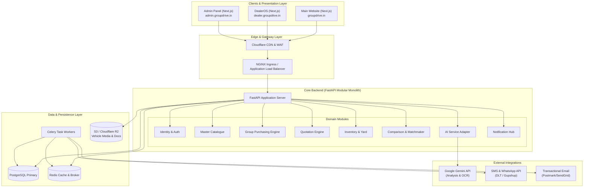
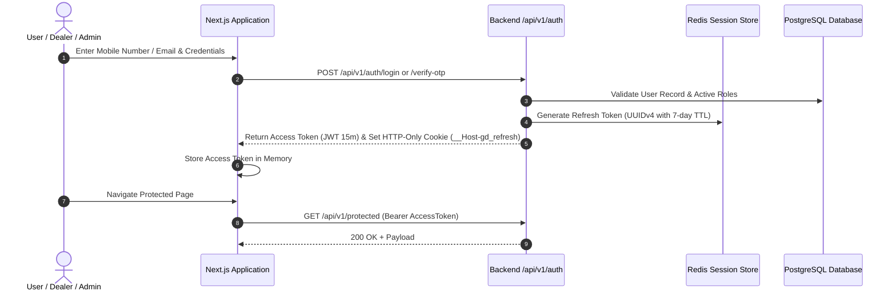
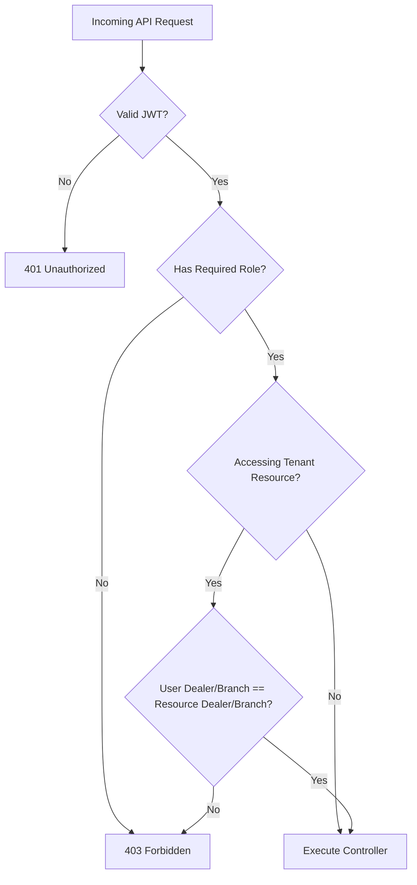
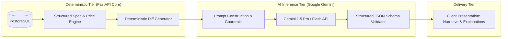
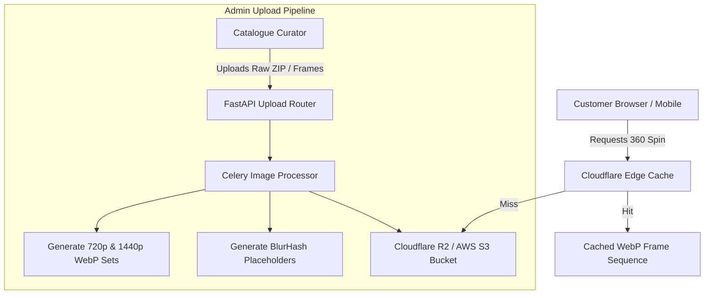
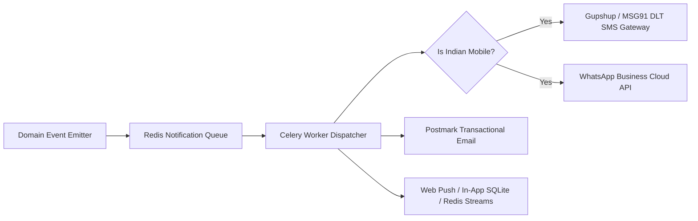
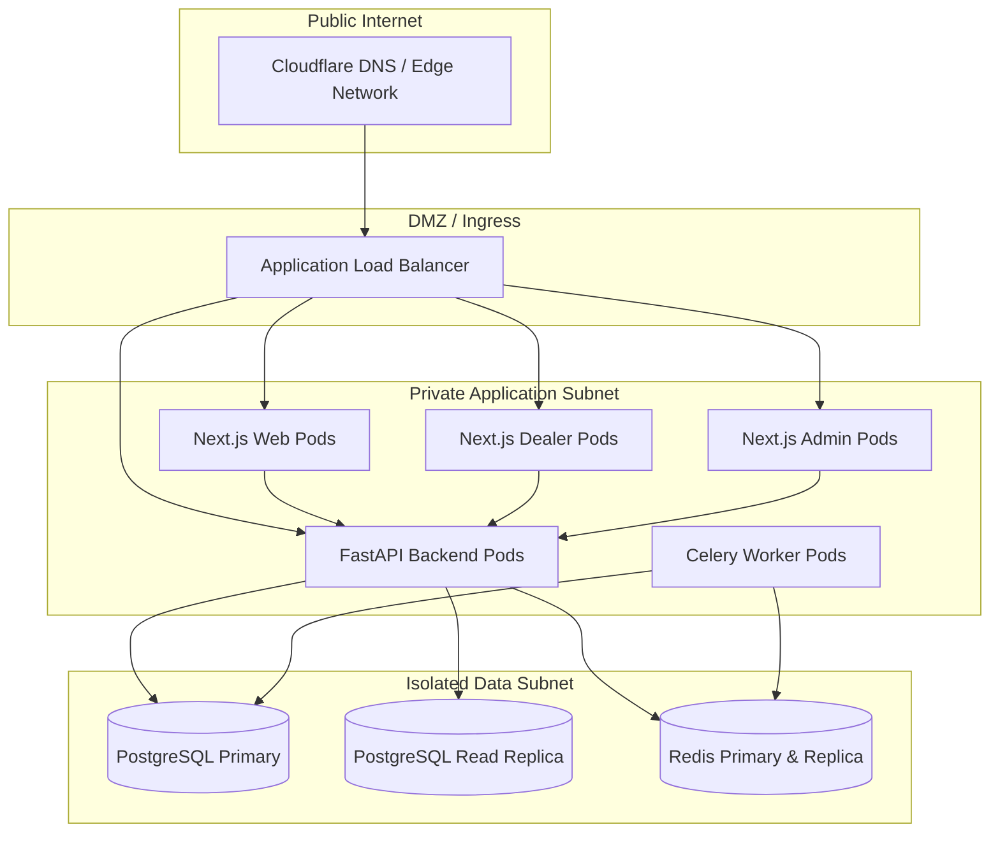

# GroupDrive – System Architecture Document

**Document Version:** 1.0.0  
**Status:** Approved Architectural Baseline  
**Classification:** Confidential & Proprietary – GroupDrive Technologies  
**Target Market:** India  
**Date:** November 2026  

---

## 1. Architecture Overview

GroupDrive is architected as an **API-first, Modular Monolith backend** powering **three independently deployable Next.js frontends** through a unified data, identity, and domain logic infrastructure.

The platform deliberately rejects premature microservice decomposition in favor of a cohesive, strongly typed modular monolith. Domain boundaries are enforced at the code and package level, preserving transaction integrity, simplifying multi-tenant database operations, and eliminating distributed transaction complexity.



---

## 2. Architectural Principles

1. **Monolith First, Strict Domain Boundaries:** Avoid distributed systems overhead during initial high-velocity growth. Domain isolation is enforced via Python modules and strict dependency injection.
2. **API-First & Contract-Driven:** All presentation tiers consume identical, versioned REST endpoints (`/api/v1/`) validated through Pydantic v2 models and OpenAPI 3.1 contracts.
3. **Single Source of Truth:** Master vehicle specifications are authoritative and immutable from external tenants. Dealerships operate in isolated multi-tenant workspaces.
4. **Deterministic Before Generative:** Vehicle comparisons, EMI calculations, RTO statutory taxes, and scoring matrices execute deterministically on the backend. AI (Google Gemini) provides natural language explanation, OCR extraction, and semantic analysis without ever inventing baseline facts.
5. **Asynchronous Non-Blocking Execution:** Heavy computations, document OCR, notifications, and scheduled lifecycle sweeps are offloaded to Redis-backed Celery workers.
6. **Stateless Scalability:** Backend application nodes are strictly stateless, enabling instant horizontal auto-scaling behind load balancers.

---

## 3. System Design Decisions

| Decision | Selected Choice | Rejected Alternative | Architectural Rationale |
|---|---|---|---|
| **Monorepo Strategy** | Turborepo / PNPM Workspaces | Polyrepo (multi-repository) | Shared TypeScript types, unified linting, synchronized API contracts between frontend and backend. |
| **Backend Architecture** | Modular Monolith (FastAPI) | Microservices (gRPC / Event-mesh) | Eliminates distributed transaction rollbacks (2PC), reduces operational complexity, and enables atomic relational queries. |
| **Backend Language** | Python 3.11+ (FastAPI + AsyncPG) | Node.js (NestJS) / Go | Optimal ecosystem for AI integrations (Gemini SDK, data modeling), asynchronous high-throughput I/O, and rapid development speed. |
| **Database Engine** | PostgreSQL 16 | MongoDB / DynamoDB | Strict ACID guarantees required for group capacity reservations, complex multi-table joins for vehicle variants, and robust JSONB indexing. |
| **Frontend Framework** | Next.js 14+ (App Router) | Single Page App (Pure React Vite) | Server-Side Rendering (SSR) and Incremental Static Regeneration (ISR) are critical for car discovery SEO, while supporting rich client-side interactivity. |
| **UI Component Library** | Tailwind CSS + shadcn/ui | MUI / Ant Design | Unstyled, accessible, zero-runtime overhead, completely customizable design tokens shared across all 3 frontends. |

---

## 4. Monorepo Strategy

The repository follows a clean Turborepo workspace structure:

```
groupdrive/
├── apps/
│   ├── web/                  # Customer Marketplace (groupdrive.in)
│   ├── dealer/               # DealerOS SaaS (dealer.groupdrive.in)
│   ├── admin/                # Platform Admin Panel (admin.groupdrive.in)
│   └── backend/              # FastAPI Modular Monolith
├── packages/
│   ├── ui/                   # Shared React component library (shadcn/ui based)
│   ├── types/                # Shared TypeScript DTO interfaces generated from OpenAPI
│   ├── config/               # Shared ESLint, Prettier, Tailwind, and TS configs
│   └── utils/                # Shared mathematical, currency, and date formatting utilities
├── docker/                   # Dockerfiles and docker-compose configurations
└── docs/                     # Master engineering & product documentation
```

---

## 5. Three-Application Architecture

```mermaid
graph LR
    subgraph "Application 1: Main Website"
        A1[groupdrive.in] -->|Customer Journey| R1[Discovery, 360 Spin, Groups, Quotation Compare]
    end

    subgraph "Application 2: DealerOS"
        A2[dealer.groupdrive.in] -->|Dealer Journey| R2[Demand Radar, Flash Campaigns, Quotations, Yard Tracking]
    end

    subgraph "Application 3: Admin Panel"
        A3[admin.groupdrive.in] -->|Admin Journey| R3[Master Specs, KYC Approval, Group Audits, Fraud Monitoring]
    end

    R1 -->|Authenticated Session| API[/api/v1/...]
    R2 -->|Multi-Tenant Scoped Session| API
    R3 -->|Elevated RBAC Session| API
```

Each frontend application is an independent Next.js project with its own `next.config.js`, dependencies, and deployment pipeline. They share design tokens and common UI primitives from `packages/ui` but maintain distinct routing and layout structures.

---

## 6. Backend Architecture & Application Layers

The backend follows a strict **Clean Architecture (Layered Hexagonal)** pattern:

```
┌────────────────────────────────────────────────────────┐
│ 1. API Presentation Layer (FastAPI Routers)            │
│    - Route definitions, Path parameters, Query params  │
│    - Pydantic v2 Request/Response validation schemas   │
│    - Dependency injection of current user and services │
├────────────────────────────────────────────────────────┤
│ 2. Security & Policy Layer (Guards & Middlewares)      │
│    - JWT validation, Token refresh, CORS, Rate limits  │
│    - Role-Based Access Control (RBAC)                  │
│    - Multi-Tenant Dealership Isolation enforcement     │
├────────────────────────────────────────────────────────┤
│ 3. Domain Service Layer (Pure Business Logic)          │
│    - Group lifecycle state machine                     │
│    - Deterministic comparison algorithms               │
│    - Quotation mathematical validation & statutory fee │
│    - Gemini prompt orchestration & response parsing    │
├────────────────────────────────────────────────────────┤
│ 4. Data Access Layer (Repositories & Unit of Work)     │
│    - SQLAlchemy 2.0 Async ORM queries                  │
│    - Row-level locking (SELECT FOR UPDATE)             │
│    - PostgreSQL JSONB and full-text search queries     │
├────────────────────────────────────────────────────────┤
│ 5. Infrastructure & Adapters Layer                     │
│    - Redis caching & Celery background tasks           │
│    - S3 / R2 presigned URL generators                  │
│    - External SMS/WhatsApp & Gemini AI clients         │
└────────────────────────────────────────────────────────┘
```

---

## 7. Modular Monolith Structure

The backend application (`apps/backend/src/`) is organized into cohesive functional domains:

```
src/
├── core/                     # Database engine, config settings, base models, security
├── modules/
│   ├── auth/                 # Identity, JWT, password hashing, OTP verification
│   ├── users/                # Customer profiles, dealer staff accounts, preferences
│   ├── dealers/              # Dealership legal entities, KYC documents, branch hierarchy
│   ├── catalogue/            # Brands, Models, Trims, Variants, Specifications, Colours
│   ├── inventory/            # Dealership branch yard inventory, VIN tracking
│   ├── groups/               # Group creation, member joins, capacity, state machine
│   ├── campaigns/            # Dealership volume discounts & flash promotional campaigns
│   ├── quotations/           # Itemized price sheets, statutory validations, reverse bids
│   ├── comparisons/          # Deterministic comparison matrix, attribute differencing
│   ├── recommendations/      # Matchmaker scoring algorithms, questionnaire processing
│   ├── ai/                   # Gemini API client, quotation OCR parsing, narrative synthesis
│   ├── notifications/        # Multi-channel dispatcher (SMS, WhatsApp, Email, In-app)
│   ├── analytics/            # Demand aggregation, dealer benchmarks, platform metrics
│   └── admin/                # Global governance, audit trail logs, platform fee billing
└── worker/                   # Celery tasks and scheduled periodic cron jobs (Celery Beat)
```

---

## 8. API-First Architecture

All endpoints reside under the `/api/v1/` prefix.
- **Contract Enforcement:** Request and response schemas are strictly validated using Pydantic v2 models.
- **Automatic Client Generation:** The backend emits `openapi.json` at build time. Turborepo runs an automated script (`openapi-typescript`) generating strongly typed TypeScript definitions into `packages/types`.
- **Standardized Response Envelope:**

```json
{
  "success": true,
  "data": { ... },
  "message": "Operation completed successfully",
  "meta": {
    "page": 1,
    "limit": 20,
    "total": 142
  }
}
```

---

## 9. Authentication Architecture



### Cross-Subdomain Security & Session Handling
- **Domains:** `groupdrive.in`, `dealer.groupdrive.in`, `admin.groupdrive.in`.
- **Access Tokens:** Short-lived JWTs ($15\text{ minutes}$) containing `sub` (User ID), `roles` (List of role keys), `dealer_id` (if applicable), and `branch_id`.
- **Refresh Tokens:** Opaque tokens stored in PostgreSQL and cached in Redis. Passed in an HTTP-Only, Secure, `SameSite=Strict` cookie scoped to the root domain (`.groupdrive.in`).
- **Token Rotation:** Every refresh invocation invalidates the prior refresh token and issues a new pair, thwarting token replay attacks.

---

## 10. Authorization Architecture (RBAC & Multi-Tenancy)



### Multi-Tenant Dealership Isolation
- **Tenant Scope:** Every dealership entity is assigned a primary `dealer_id`. Every branch is assigned a `branch_id`.
- **Enforcement Mechanism:** Repositories automatically apply SQL filters `WHERE dealer_id = :current_user_dealer_id`. It is architecturally impossible for a branch manager from Dealership A to read or alter quotations or inventory belonging to Dealership B.
- **Super Admin Bypass:** Super Admins can query across all tenants; every access is captured in immutable audit logs.

---

## 11. Database Architecture

- **PostgreSQL 16 Engine:** Fully normalized relational schema with extensive foreign key integrity and check constraints.
- **Connection Management:** Connection pooling handled via SQLAlchemy `AsyncEngine` with `asyncpg` driver. Production deployments utilize PgBouncer for high-concurrency pool multiplexing.
- **JSONB Utilization:** Non-relational, highly polymorphic vehicle equipment (e.g., ADAS sub-features, infotainment codecs) are stored in indexed PostgreSQL `JSONB` columns with GIN indexes, balancing structural integrity with schema agility.

---

## 12. Data Ownership Matrix

| Domain Entity | Authoritative Owner | Read Permissions | Write Permissions |
|---|---|---|---|
| Master Vehicle Catalogue | Platform Super Admin | Public (All) | Platform Super Admin & Catalogue Admin only. |
| Dealership KYC & Branches | Dealership Owner | Platform Admins, Dealer Staff | Dealership Owner (Submit), Admin (Verify/Status). |
| Physical Yard Inventory | Dealership Branch | Dealership Staff, System Engines | Branch Inventory Manager, Branch Sales Manager. |
| Group Purchasing Instance | GroupDrive Platform Engine | Public (Anonymized), Group Members | Group Creator (Init), System Lifecycle Engine. |
| Dealer Quotation | Dealership Branch | Group Members (When submitted), Admins | Branch Sales Manager, Dealership Owner. |
| Customer Profile & KYC | Customer | Customer, Verified Winning Dealer | Customer only. |

---

## 13. Shared Services

1. **Event Dispatcher & Notification Hub:** Centralized event bus triggers transactional messages across channels based on domain state events (`GroupLockedEvent`, `QuotationSubmittedEvent`).
2. **Media & Document Processor:** Manages image compression, WebP conversion, watermark stamping for dealer documents, and S3 upload pipelines.
3. **Cache Manager:** Redis abstraction providing standardized keyspacing (`cat:model:{id}`, `grp:city:{id}`) and automated invalidation hooks on mutation.

---

## 14. AI Architecture (Google Gemini Integration)



### Prompt Engineering Guardrails
- **Zero Hallucination Guarantee:** Prompts pass strict system instructions: *"You are an automotive analyst. You must exclusively use the JSON payload provided below. If a specification is null or absent, state that it is unconfirmed. Do not extrapolate horsepower, price, or safety ratings."*
- **Temperature Configuration:** Temperature set to $0.1$ for quotation document OCR extraction and $0.3$ for vehicle comparison explanations to enforce factual determinism.
- **Graceful Degradation:** If the Gemini API experiences downtime or rate limits, the UI falls back smoothly to pure tabular deterministic comparison metrics without breaking the user experience.

---

## 15. Vehicle Comparison Engine Architecture

1. **Input:** Array of 2 to 4 `variant_id` UUIDs.
2. **Extraction:** Asynchronous parallel retrieval of variant records, specification matrices, and standard equipment tables.
3. **Differencing Algorithm:**
   - Computes mathematical delta for numerical fields (BHP, Torque, Boot space, Price).
   - Computes boolean difference sets for equipment (e.g., Variant A has Sunroof; Variant B does not).
4. **Output Payload:** Structured hierarchical tree of `EqualAttributes` vs. `DifferentAttributes` ready for client-side rendering.

---

## 16. Recommendation Engine Architecture

- **Stage 1 (Deterministic Filtering):** User lifestyle preferences (budget, seating capacity, fuel preference) filter out ineligible variants via SQL index scans.
- **Stage 2 (Multi-Criteria Decision Scoring):**
  $$S = 0.30 \cdot S_{\text{Safety}} + 0.25 \cdot S_{\text{Efficiency}} + 0.20 \cdot S_{\text{Performance}} + 0.15 \cdot S_{\text{Space}} + 0.10 \cdot S_{\text{Features}}$$
- **Stage 3 (Natural Language Synthesis):** Gemini synthesizes an executive summary explaining why the top-ranked vehicle matches the buyer's criteria.

---

## 17. Buyer Matching Architecture

- **Clustering Criteria:**
  - Target Vehicle Model Family (e.g., Tata Nexon).
  - Geographic Proximity: Match by Indian RTO Circle / State Tax Jurisdiction (e.g., KA-01 to KA-05 for Bengaluru).
  - Delivery Urgency Window (e.g., 30-day buying intent).
- **Automated Merging:** When standalone customer enquiries reach a density of $\ge 3$ within a 15km radius for the same vehicle line, the system automatically suggests joining an active group.

---

## 18. Quotation Intelligence Architecture

- **Automated Validation:** Incoming dealer quotes pass through a validation rule chain:
  - Validates Ex-Showroom against master catalogue base rate.
  - Recalculates State RTO tax based on published state slabs.
  - Flags prohibited terms (e.g., "Handling", "Depot Charges", "Mandatory Teflon Coating").
- **Gemini Multimodal OCR:** Scans physical paper quotes uploaded by buyers to benchmark them against GroupDrive group offers.

---

## 19. Media and 360-Degree Architecture



The 360° viewer loads an optimized sprite/frame array (36 frames at $10^\circ$ increments). Low-resolution placeholders load immediately, progressively streaming high-resolution frames as the user rotates the vehicle.

---

## 20. File Storage Architecture

- **Storage Provider:** S3-compatible object store (MinIO for local development; AWS S3 / Cloudflare R2 for production).
- **Security:**
  - *Public Assets:* Vehicle catalogue photos, brochures, 360° image sequences delivered via public CDN edge.
  - *Private Assets:* Dealer GST certificates, PAN cards, customer KYC documents, booking invoices stored in private buckets accessible only via short-lived ($15\text{ min}$) presigned URLs.

---

## 21. Notification Architecture



All outbound Indian SMS messages adhere strictly to TRAI DLT registration templates with registered Sender IDs and PE IDs.

---

## 22. Background Processing (Celery & Redis)

- **Worker Queues:**
  - `high_priority`: Auth OTP delivery, quotation notification alerts.
  - `default`: Group status state transitions, quotation validation sweeps.
  - `low_priority`: Image optimization, daily analytical rollups, report generation.
- **Scheduled Tasks (Celery Beat):**
  - Group Expiry Sweeper (Runs hourly): Moves expired `FORMING` groups to `EXPIRED`.
  - Quotation Window Sweeper (Runs every 15 mins): Closes bidding windows.
  - Dealer SLA Monitor (Runs every 30 mins): Escalates unacknowledged quotes to Dealership General Managers.

---

## 23. Caching Strategy

```
┌─────────────────────────────────────────────────────────────┐
│ 1. Browser HTTP Cache (Static Assets, Icons, Fonts)         │
├─────────────────────────────────────────────────────────────┤
│ 2. Cloudflare Edge Cache (360 Images, Vehicle Brochures)    │
├─────────────────────────────────────────────────────────────┤
│ 3. Redis Application Cache                                  │
│    - Master Catalogue Brands & Models (TTL: 24 Hours)       │
│    - Vehicle Variant Specifications (TTL: 12 Hours)         │
│    - Active Regional Groups List (TTL: 3 Minutes)           │
│    - Dynamic On-Road Tax Matrices (TTL: 7 Days)             │
├─────────────────────────────────────────────────────────────┤
│ 4. PostgreSQL Query Cache / Buffer Pool                     │
└─────────────────────────────────────────────────────────────┘
```

Automated cache invalidation triggers on any mutation in the Admin Master Catalogue.

---

## 24. Error Handling & Standardized Responses

The platform implements RFC 7807 (Problem Details for HTTP APIs):

```json
{
  "type": "https://groupdrive.in/errors/group-capacity-exceeded",
  "title": "Group Capacity Exceeded",
  "status": 409,
  "detail": "The targeted Tata Nexon Bangalore group has reached its maximum capacity of 15 members.",
  "instance": "/api/v1/groups/7f8a9b2c-1234-4567-89ab-cdef01234567/join",
  "error_code": "ERR_GRP_CAPACITY_FULL",
  "timestamp": "2026-11-06T15:30:00Z"
}
```

---

## 25. Logging and Monitoring

- **Structured Logging:** All logs emitted in JSON format via Python `structlog`, containing `request_id`, `user_id`, `tenant_id`, and `execution_duration_ms`.
- **Metrics Collection:** Prometheus endpoint `/metrics` exports system metrics (request latency percentiles, error rates, database connection pool saturation).
- **Application Performance Monitoring (APM):** Sentry for unhandled exception capture and distributed transaction tracing across frontend and backend.

---

## 26. Security Architecture

- **Network Security:** Strict Cloudflare WAF rules, DDoS protection, rate limiting (100 req/min for public search, 5 req/min for OTP generation).
- **Application Security:**
  - Content Security Policy (CSP) blocking unauthorized script injection.
  - SQL Injection prevention through strict SQLAlchemy parameter binding.
  - Cross-Site Request Forgery (CSRF) mitigation via SameSite HTTP-only cookies and custom header verification (`X-Requested-With`).
- **Data Protection:** Encrypted database fields for sensitive PII (Aadhaar numbers, bank account details) using AES-256 GCM.

---

## 27. Scalability Strategy

- **Stateless Backend Nodes:** Horizontally autoscaled across Kubernetes pods or AWS ECS tasks based on CPU/Memory thresholds ($> 70\%$).
- **Database Read Scaling:** PostgreSQL Primary handles all write traffic; asynchronous Read Replicas serve public vehicle catalogue queries and search filtering.
- **Static Asset Offloading:** 100% of vehicle imagery and 360° frame assets served directly via Cloudflare R2 / S3 without touching backend application servers.

---

## 28. Deployment Architecture



---

## 29. Environment Strategy

| Environment | Domain Names | Database & Data Policy | Deployment Trigger |
|---|---|---|---|
| **Local Development** | `localhost:3000`, `3001`, `3002`, `8000` | Local Dockerized PostgreSQL & Redis. Seed data populated. | Local workspace. |
| **Staging / UAT** | `staging.groupdrive.in`, `dealer-staging...` | Anonymized production snapshot. Dedicated staging cluster. | Merge to `main` branch. |
| **Production** | `groupdrive.in`, `dealer.groupdrive.in`, `admin.groupdrive.in` | Multi-AZ Primary + Replica. Real customer and dealer data. | Semantic version git tag (`v*.*.*`). |

---

## 30. Backup and Recovery

- **Automated Snapshots:** Continuous PostgreSQL Write-Ahead Log (WAL) archiving to off-site object storage via `pgBackRest` or AWS RDS automated backups.
- **Snapshot Cadence:** Daily full database snapshots retained for 30 days; weekly snapshots retained for 12 months.
- **Disaster Recovery Objectives:**
  - **Recovery Point Objective (RPO):** $< 15\text{ minutes}$ (maximum allowable data loss in catastrophic failure).
  - **Recovery Time Objective (RTO):** $< 2\text{ hours}$ (maximum allowable downtime to restore service in alternate cloud region).

---

## 31. Integration Strategy

- **SMS & WhatsApp Gateways:** Gupshup / MSG91 REST APIs with webhook callbacks for delivery status reporting.
- **AI Services:** Google Cloud Vertex AI / Gemini API via official Python client with client-side connection pooling.
- **Payment & Token Gateways (Future):** Razorpay / Cashfree for refundable booking tokens and platform fee collections.
- **Government Portals (Future):** MoRTH Vahan API integrations via authorized National Informatics Centre (NIC) data partners for real-time RTO rate lookups.

---

## 32. Future Architecture Evolution

1. **Event Streaming (Kafka):** Transition from Redis pub/sub to Apache Kafka once platform events exceed 5,000 events/second.
2. **PostGIS Spatial Clustering:** Enhance buyer group formation with native PostgreSQL PostGIS geospatial indexing for boundary polygons and commute corridor matching.
3. **Selective Microservice Extraction:** If the Quotation Engine or Master Catalogue requires independent scaling or organizational isolation, extract into dedicated gRPC microservices.
