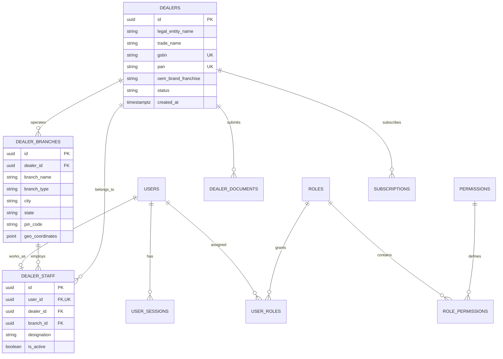
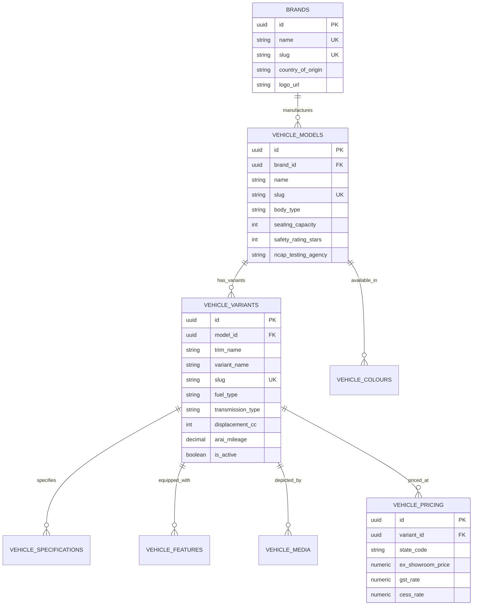
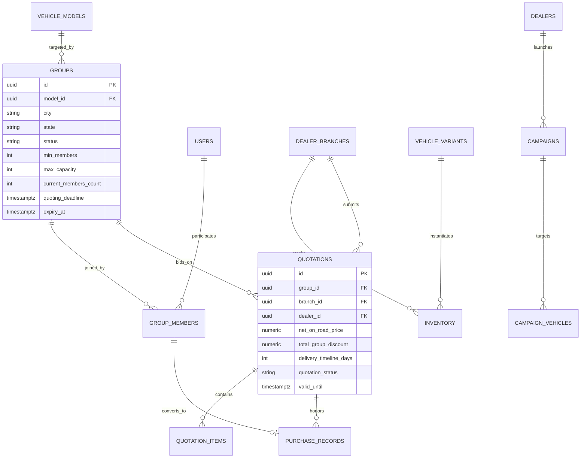

# GroupDrive – Database Design & Data Architecture

**Document Version:** 1.0.0  
**Status:** Approved Architectural Baseline  
**Classification:** Confidential & Proprietary – GroupDrive Technologies  
**Engine:** PostgreSQL 16+ (Extensions: `uuid-ossp`, `pgcrypto`, `btree_gist`, `citext`)  
**ORM & Migrations:** SQLAlchemy 2.0 (Async) + Alembic  
**Target Market:** India  
**Date:** November 2026  

---

## 1. Data Architecture Principles

1. **Normalized Relational Baseline:** Third Normal Form (3NF) is enforced for transactional integrity across users, dealerships, inventory, groups, and binding quotations.
2. **Selective JSONB Denormalization:** Polymorphic, rapidly evolving vehicle attributes (e.g., ADAS sensor specifications, infotainment codecs, connected car telematics) utilize indexed PostgreSQL `JSONB` with GIN indexing to prevent continuous DDL migrations.
3. **Immutable Master Catalogue:** Master vehicle specifications are globally accessible across all tenants in read-only mode. Dealers cannot insert, update, or delete master vehicle records.
4. **Strict Multi-Tenant Isolation:** Dealership data (inventory, branch staff, private campaigns, itemized bids) enforces foreign key tenancy down to `dealer_id` and `branch_id`. Queries apply tenant predicates at the repository layer.
5. **Surrogate Keys:** Primary keys use UUIDv4 (or UUIDv7 for sequential index locality), mitigating enumeration attacks and simplifying distributed data synchronization.
6. **Statutory Financial Integrity:** All monetary figures (Ex-showroom, RTO tax, TCS, insurance, discounts) are stored as 64-bit integer paise (`BIGINT`, where ₹1.00 = 100 paise) or `NUMERIC(14, 2)` to eliminate floating-point rounding errors.

---

## 2. Global Entity Relationship Diagrams (ERD)

### 2.1 Core Identity, Multi-Branch Dealership & Staff Hierarchy



### 2.2 Central Master Vehicle Catalogue



### 2.3 Group Purchasing, Campaigns, Quotations & Purchase Records



---

## 3. Database Entities & Table Specifications

### 3.1 Module: Identity, Authentication & RBAC

#### 1. `users`
*Purpose:* Primary user identity record across all three applications (Customers, Dealer Staff, Administrators).
- `id` (UUID, PK, Default: `gen_random_uuid()`): Unique user ID.
- `phone_number` (`VARCHAR(15)`, Unique, Nullable): E.164 format (+919876543210). Primary credential in India.
- `email` (`CITEXT`, Unique, Nullable): Case-insensitive email address.
- `password_hash` (`VARCHAR(255)`, Nullable): Argon2id or bcrypt hash (null for pure OTP users).
- `is_phone_verified` (`BOOLEAN`, Default: `FALSE`): Verification status via SMS OTP.
- `is_email_verified` (`BOOLEAN`, Default: `FALSE`): Verification status via magic link/OTP.
- `is_active` (`BOOLEAN`, Default: `TRUE`): Soft-kill / suspension switch.
- `is_deleted` (`BOOLEAN`, Default: `FALSE`): Soft-delete flag.
- `created_at` (`TIMESTAMPTZ`, Default: `NOW()`): Account creation timestamp.
- `updated_at` (`TIMESTAMPTZ`, Default: `NOW()`): Last mutation timestamp.
*Constraints:* Check `phone_number IS NOT NULL OR email IS NOT NULL`.

#### 2. `user_profiles`
*Purpose:* Extended customer personal profile, KYC documents, and geographic attributes.
- `id` (`UUID`, PK, Default: `gen_random_uuid()`)
- `user_id` (`UUID`, FK `users.id` ON DELETE CASCADE, Unique, Indexed)
- `first_name` (`VARCHAR(100)`, Nullable)
- `last_name` (`VARCHAR(100)`, Nullable)
- `city` (`VARCHAR(100)`, Indexed)
- `state` (`VARCHAR(100)`)
- `pin_code` (`VARCHAR(10)`, Indexed)
- `preferred_rto_code` (`VARCHAR(10)`, Nullable): e.g., "KA-03", "MH-02".
- `kyc_status` (`VARCHAR(30)`, Default: `'UNVERIFIED'`): `UNVERIFIED`, `SUBMITTED`, `VERIFIED`, `REJECTED`.
- `driving_license_number_masked` (`VARCHAR(30)`, Nullable)
- `avatar_url` (`VARCHAR(500)`, Nullable)
- `notification_preferences` (`JSONB`, Default: `'{"sms": true, "whatsapp": true, "email": true}'`)

#### 3. `roles`
*Purpose:* Master list of authorization roles.
- `id` (`UUID`, PK, Default: `gen_random_uuid()`)
- `code` (`VARCHAR(50)`, Unique, Indexed): e.g., `ROLE_CUSTOMER`, `ROLE_DEALER_OWNER`, `ROLE_BRANCH_MANAGER`, `ROLE_SALES_EXECUTIVE`, `ROLE_SUPER_ADMIN`.
- `name` (`VARCHAR(100)`): Human-readable name.
- `description` (`TEXT`)
- `is_system_role` (`BOOLEAN`, Default: `TRUE`)

#### 4. `permissions`
*Purpose:* Atomic capability descriptors.
- `id` (`UUID`, PK, Default: `gen_random_uuid()`)
- `code` (`VARCHAR(100)`, Unique, Indexed): e.g., `catalogue:write`, `quotation:submit`, `inventory:read`, `group:create`.
- `module` (`VARCHAR(50)`): Logical grouping.
- `description` (`TEXT`)

#### 5. `role_permissions`
*Purpose:* Many-to-Many mapping of Roles to Atomic Permissions.
- `role_id` (`UUID`, FK `roles.id` ON DELETE CASCADE, Composite PK)
- `permission_id` (`UUID`, FK `permissions.id` ON DELETE CASCADE, Composite PK)

#### 6. `user_roles`
*Purpose:* Assignment of roles to users with optional tenant scoping.
- `id` (`UUID`, PK, Default: `gen_random_uuid()`)
- `user_id` (`UUID`, FK `users.id` ON DELETE CASCADE, Indexed)
- `role_id` (`UUID`, FK `roles.id` ON DELETE CASCADE, Indexed)
- `created_at` (`TIMESTAMPTZ`, Default: `NOW()`)
*Constraints:* Unique composite `(user_id, role_id)`.

#### 7. `user_sessions`
*Purpose:* Active refresh tokens and persistent device sessions.
- `id` (`UUID`, PK, Default: `gen_random_uuid()`)
- `user_id` (`UUID`, FK `users.id` ON DELETE CASCADE, Indexed)
- `refresh_token_hash` (`VARCHAR(255)`, Unique, Indexed)
- `user_agent` (`TEXT`, Nullable)
- `ip_address` (`INET`, Nullable)
- `is_revoked` (`BOOLEAN`, Default: `FALSE`)
- `expires_at` (`TIMESTAMPTZ`, Indexed)
- `created_at` (`TIMESTAMPTZ`, Default: `NOW()`)

---

### 3.2 Module: Dealerships, Branches & Staff Hierarchy

#### 8. `dealers`
*Purpose:* Legal entity representing an authorized automotive dealership franchise.
- `id` (`UUID`, PK, Default: `gen_random_uuid()`)
- `legal_entity_name` (`VARCHAR(200)`, Indexed): Registered corporate/firm name.
- `trade_name` (`VARCHAR(200)`): Customer-facing brand name.
- `gstin` (`VARCHAR(15)`, Unique, Indexed): Indian 15-character GST Number.
- `pan` (`VARCHAR(10)`, Unique, Indexed): Indian Permanent Account Number.
- `oem_brand_franchise` (`VARCHAR(100)`, Indexed): Authorized OEM (e.g., "Tata Motors Passenger Vehicles").
- `registered_office_address` (`TEXT`)
- `primary_contact_email` (`CITEXT`)
- `primary_contact_phone` (`VARCHAR(15)`)
- `kyc_status` (`VARCHAR(30)`, Default: `'PENDING_REVIEW'`, Indexed): `PENDING_REVIEW`, `VERIFIED`, `REJECTED`, `SUSPENDED`.
- `verified_at` (`TIMESTAMPTZ`, Nullable)
- `verified_by_admin_id` (`UUID`, FK `users.id`, Nullable)
- `created_at` (`TIMESTAMPTZ`, Default: `NOW()`)

#### 9. `dealer_documents`
*Purpose:* Uploaded statutory and franchise proof documents.
- `id` (`UUID`, PK, Default: `gen_random_uuid()`)
- `dealer_id` (`UUID`, FK `dealers.id` ON DELETE CASCADE, Indexed)
- `document_type` (`VARCHAR(50)`): `GST_CERTIFICATE`, `PAN_CARD`, `OEM_AUTHORIZATION_LETTER`, `TRADE_CERTIFICATE`, `BANK_CANCELLED_CHEQUE`.
- `document_url` (`VARCHAR(500)`): S3 private object path.
- `verification_status` (`VARCHAR(30)`, Default: `'PENDING'`): `PENDING`, `ACCEPTED`, `REJECTED`.
- `rejection_reason` (`TEXT`, Nullable)
- `uploaded_at` (`TIMESTAMPTZ`, Default: `NOW()`)

#### 10. `dealer_branches`
*Purpose:* Physical showroom outlets and stockyard delivery centers.
- `id` (`UUID`, PK, Default: `gen_random_uuid()`)
- `dealer_id` (`UUID`, FK `dealers.id` ON DELETE CASCADE, Indexed)
- `branch_name` (`VARCHAR(150)`): e.g., "Kalyani Motors - Whitefield Showroom".
- `branch_type` (`VARCHAR(30)`): `SHOWROOM_AND_SERVICE`, `SHOWROOM_ONLY`, `STOCKYARD_ONLY`.
- `address_line1` (`VARCHAR(255)`)
- `address_line2` (`VARCHAR(255)`, Nullable)
- `city` (`VARCHAR(100)`, Indexed)
- `state` (`VARCHAR(100)`, Indexed)
- `pin_code` (`VARCHAR(10)`, Indexed)
- `authorized_rto_codes` (`TEXT[]`): Array of RTO jurisdictions (e.g., `ARRAY['KA-01', 'KA-03', 'KA-53']`).
- `latitude` (`NUMERIC(10, 7)`, Nullable)
- `longitude` (`NUMERIC(10, 7)`, Nullable)
- `phone_number` (`VARCHAR(15)`)
- `is_active` (`BOOLEAN`, Default: `TRUE`)

#### 11. `dealer_staff`
*Purpose:* Maps users to dealership entities and specific branches with organizational designations.
- `id` (`UUID`, PK, Default: `gen_random_uuid()`)
- `user_id` (`UUID`, FK `users.id` ON DELETE CASCADE, Unique, Indexed)
- `dealer_id` (`UUID`, FK `dealers.id` ON DELETE CASCADE, Indexed)
- `branch_id` (`UUID`, FK `dealer_branches.id` ON DELETE SET NULL, Nullable, Indexed)
- `designation` (`VARCHAR(100)`): e.g., "General Sales Manager", "Senior Product Genius".
- `staff_role` (`VARCHAR(50)`, Indexed): `DEALER_OWNER`, `BRANCH_MANAGER`, `SALES_MANAGER`, `SALES_EXECUTIVE`, `INVENTORY_MANAGER`, `FINANCE_EXECUTIVE`.
- `is_active` (`BOOLEAN`, Default: `TRUE`)
- `created_at` (`TIMESTAMPTZ`, Default: `NOW()`)

---

### 3.3 Module: Master Vehicle Catalogue (Central Governance)

#### 12. `brands`
*Purpose:* Automotive manufacturers operating in India.
- `id` (`UUID`, PK, Default: `gen_random_uuid()`)
- `name` (`VARCHAR(100)`, Unique, Indexed): e.g., "Tata Motors", "Hyundai", "Mahindra".
- `slug` (`VARCHAR(100)`, Unique, Indexed): e.g., "tata-motors", "hyundai".
- `country_of_origin` (`VARCHAR(100)`)
- `logo_url` (`VARCHAR(500)`)
- `is_active` (`BOOLEAN`, Default: `TRUE`)

#### 13. `vehicle_models`
*Purpose:* Vehicle product lines.
- `id` (`UUID`, PK, Default: `gen_random_uuid()`)
- `brand_id` (`UUID`, FK `brands.id` ON DELETE RESTRICT, Indexed)
- `name` (`VARCHAR(100)`, Indexed): e.g., "Nexon", "Creta", "Scorpio-N".
- `slug` (`VARCHAR(120)`, Unique, Indexed): e.g., "tata-nexon", "hyundai-creta".
- `body_type` (`VARCHAR(50)`, Indexed): `COMPACT_SUV`, `MID_SUV`, `FULL_SUV`, `HATCHBACK`, `SEDAN`, `MPV`.
- `seating_capacity` (`SMALLINT`, Indexed): 5, 6, 7.
- `safety_rating_stars` (`SMALLINT`, Nullable): 0 to 5.
- `safety_rating_agency` (`VARCHAR(50)`, Nullable): `BHARAT_NCAP`, `GLOBAL_NCAP`.
- `ground_clearance_mm` (`SMALLINT`, Nullable)
- `boot_space_litres` (`SMALLINT`, Nullable)
- `is_active` (`BOOLEAN`, Default: `TRUE`)

#### 14. `vehicle_variants`
*Purpose:* Specific trim, engine, and gearbox configuration.
- `id` (`UUID`, PK, Default: `gen_random_uuid()`)
- `model_id` (`UUID`, FK `vehicle_models.id` ON DELETE RESTRICT, Indexed)
- `trim_name` (`VARCHAR(50)`, Indexed): e.g., "Creative+", "SX(O)", "Z8L".
- `variant_name` (`VARCHAR(150)`, Indexed): Full commercial name (e.g., "Creative Plus 1.2 Turbo Petrol 6MT").
- `slug` (`VARCHAR(200)`, Unique, Indexed)
- `fuel_type` (`VARCHAR(30)`, Indexed): `PETROL`, `DIESEL`, `CNG`, `STRONG_HYBRID`, `ELECTRIC`.
- `transmission_type` (`VARCHAR(30)`, Indexed): `MANUAL`, `AUTOMATED_MANUAL_AMT`, `IMT`, `TORQUE_CONVERTER_AT`, `DUAL_CLUTCH_DCT`, `CVT`.
- `transmission_speeds` (`SMALLINT`, Default: 6)
- `engine_displacement_cc` (`SMALLINT`, Nullable)
- `max_power_bhp` (`NUMERIC(6, 2)`, Indexed)
- `max_torque_nm` (`NUMERIC(6, 2)`, Indexed)
- `emission_norm` (`VARCHAR(50)`, Default: `'BS6_PHASE_2'`): `BS6_PHASE_2_RDE_E20`.
- `arai_mileage` (`NUMERIC(4, 2)`, Nullable): km/l or km/kg or km/kWh.
- `is_active` (`BOOLEAN`, Default: `TRUE`)

#### 15. `vehicle_specifications`
*Purpose:* Detailed engineering parameters grouped by category.
- `id` (`UUID`, PK, Default: `gen_random_uuid()`)
- `variant_id` (`UUID`, FK `vehicle_variants.id` ON DELETE CASCADE, Indexed)
- `category` (`VARCHAR(50)`, Indexed): `ENGINE_PERFORMANCE`, `DIMENSIONS_WEIGHT`, `SUSPENSION_BRAKES`, `STEERING_TYRES`.
- `specification_key` (`VARCHAR(100)`, Indexed): e.g., `front_brake_type`, `rear_suspension`, `wheel_size`.
- `specification_value` (`VARCHAR(255)`)
- `unit` (`VARCHAR(30)`, Nullable)
*Constraints:* Unique composite `(variant_id, specification_key)`.

#### 16. `vehicle_features`
*Purpose:* Equipment checklist matrix for comparison and filtering.
- `id` (`UUID`, PK, Default: `gen_random_uuid()`)
- `variant_id` (`UUID`, FK `vehicle_variants.id` ON DELETE CASCADE, Indexed)
- `feature_group` (`VARCHAR(50)`, Indexed): `SAFETY`, `COMFORT_CONVENIENCE`, `LIGHTING`, `INFOTAINMENT`.
- `feature_key` (`VARCHAR(100)`, Indexed): e.g., `panoramic_sunroof`, `adas_level_2`, `ventilated_front_seats`, `airbag_count_6`.
- `is_available` (`BOOLEAN`, Default: `TRUE`)
- `details` (`TEXT`, Nullable)
*Constraints:* Unique composite `(variant_id, feature_key)`.

#### 17. `vehicle_media`
*Purpose:* Images, 360° frame sequences, brochures, and asset links.
- `id` (`UUID`, PK, Default: `gen_random_uuid()`)
- `model_id` (`UUID`, FK `vehicle_models.id` ON DELETE CASCADE, Indexed)
- `variant_id` (`UUID`, FK `vehicle_variants.id` ON DELETE SET NULL, Nullable, Indexed)
- `media_type` (`VARCHAR(30)`, Indexed): `IMAGE_GALLERY`, `SPIN_360_FRAME_SEQUENCE`, `BROCHURE_PDF`, `HERO_BANNER`.
- `media_url` (`VARCHAR(500)`)
- `thumbnail_url` (`VARCHAR(500)`, Nullable)
- `display_order` (`SMALLINT`, Default: 0)
- `metadata` (`JSONB`, Default: `'{}'`)

#### 18. `vehicle_colours`
*Purpose:* Official manufacturer paint finishes and swatches.
- `id` (`UUID`, PK, Default: `gen_random_uuid()`)
- `model_id` (`UUID`, FK `vehicle_models.id` ON DELETE CASCADE, Indexed)
- `colour_name` (`VARCHAR(100)`): e.g., "Daytona Grey with Black Roof", "Atlas White".
- `hex_primary` (`VARCHAR(7)`): e.g., `#4A4A4A`.
- `hex_secondary` (`VARCHAR(7)`, Nullable): For dual-tone finishes.
- `is_dual_tone` (`BOOLEAN`, Default: `FALSE`)
- `additional_price` (`NUMERIC(10, 2)`, Default: 0.00)

#### 19. `vehicle_pricing`
*Purpose:* State-level official base ex-showroom pricing and statutory tax parameters.
- `id` (`UUID`, PK, Default: `gen_random_uuid()`)
- `variant_id` (`UUID`, FK `vehicle_variants.id` ON DELETE CASCADE, Indexed)
- `state_code` (`VARCHAR(5)`, Indexed): e.g., "KA", "DL", "MH", "TN".
- `ex_showroom_price` (`NUMERIC(14, 2)`, Indexed): Official price in INR.
- `gst_rate_percent` (`NUMERIC(4, 2)`, Default: 28.00)
- `cess_rate_percent` (`NUMERIC(4, 2)`, Default: 22.00)
- `effective_from` (`DATE`, Default: `CURRENT_DATE`)
*Constraints:* Unique composite `(variant_id, state_code)`.

---

### 3.4 Module: Inventory & Yard Tracking (DealerOS)

#### 20. `inventory`
*Purpose:* Physical and pipeline vehicles assigned to dealership branches.
- `id` (`UUID`, PK, Default: `gen_random_uuid()`)
- `dealer_id` (`UUID`, FK `dealers.id` ON DELETE CASCADE, Indexed)
- `branch_id` (`UUID`, FK `dealer_branches.id` ON DELETE CASCADE, Indexed)
- `variant_id` (`UUID`, FK `vehicle_variants.id` ON DELETE RESTRICT, Indexed)
- `colour_id` (`UUID`, FK `vehicle_colours.id` ON DELETE RESTRICT, Indexed)
- `vin` (`VARCHAR(17)`, Unique, Nullable): Vehicle Identification Number.
- `stock_serial_number` (`VARCHAR(50)`, Nullable): Dealership internal inventory tag.
- `manufacturing_month_year` (`VARCHAR(7)`): e.g., "08-2026".
- `status` (`VARCHAR(30)`, Default: `'IN_STOCK'`, Indexed): `IN_STOCK`, `IN_TRANSIT`, `ALLOCATED_TO_GROUP`, `SOLD`, `DELIVERED`.
- `days_in_yard` (`SMALLINT`, Default: 0)
- `yard_location` (`VARCHAR(100)`, Nullable): e.g., "Hosur Road Yard - Bay 4B".
- `is_available_for_flash_sale` (`BOOLEAN`, Default: `FALSE`, Indexed)
- `created_at` (`TIMESTAMPTZ`, Default: `NOW()`)

---

### 3.5 Module: Group Purchasing & Campaigns

#### 21. `groups`
*Purpose:* Collective purchasing instances pooling retail buyer demand.
- `id` (`UUID`, PK, Default: `gen_random_uuid()`)
- `group_code` (`VARCHAR(20)`, Unique, Indexed): Human-readable code (e.g., "GD-BLR-NEX-08").
- `model_id` (`UUID`, FK `vehicle_models.id` ON DELETE RESTRICT, Indexed)
- `city` (`VARCHAR(100)`, Indexed): Target city delivery jurisdiction.
- `state` (`VARCHAR(100)`, Indexed)
- `rto_circle` (`VARCHAR(20)`, Indexed): Regional tax/registration zone.
- `status` (`VARCHAR(30)`, Default: `'FORMING'`, Indexed): `FORMING`, `OPEN_FOR_QUOTES`, `QUOTATION_REVIEW`, `LOCKED`, `COMPLETED`, `EXPIRED`, `CANCELLED`.
- `min_members_threshold` (`SMALLINT`, Default: 3)
- `max_capacity` (`SMALLINT`, Default: 15)
- `current_members_count` (`SMALLINT`, Default: 1)
- `created_by_user_id` (`UUID`, FK `users.id`, Indexed)
- `quoting_deadline` (`TIMESTAMPTZ`, Nullable)
- `expiry_at` (`TIMESTAMPTZ`, Indexed)
- `target_delivery_window_days` (`SMALLINT`, Default: 30)
- `created_at` (`TIMESTAMPTZ`, Default: `NOW()`)
- `updated_at` (`TIMESTAMPTZ`, Default: `NOW()`)

#### 22. `group_members`
*Purpose:* Individual customer participation in a collective purchasing group.
- `id` (`UUID`, PK, Default: `gen_random_uuid()`)
- `group_id` (`UUID`, FK `groups.id` ON DELETE CASCADE, Indexed)
- `user_id` (`UUID`, FK `users.id` ON DELETE CASCADE, Indexed)
- `selected_variant_id` (`UUID`, FK `vehicle_variants.id` ON DELETE RESTRICT, Indexed)
- `selected_colour_id` (`UUID`, FK `vehicle_colours.id` ON DELETE RESTRICT)
- `membership_status` (`VARCHAR(30)`, Default: `'ACTIVE'`, Indexed): `ACTIVE`, `LOCKED`, `LEFT_GROUP`, `ORDER_PLACED`, `DELIVERED`.
- `finance_preference` (`VARCHAR(30)`): `SELF_FINANCED_CASH`, `BANK_LOAN`, `UNDECIDED`.
- `exchange_vehicle_details` (`JSONB`, Nullable): Old vehicle trade-in information.
- `joined_at` (`TIMESTAMPTZ`, Default: `NOW()`)
*Constraints:* Unique composite `(group_id, user_id)` (A user cannot join the same group twice).

#### 23. `campaigns`
*Purpose:* Dealer-initiated volume promotion campaigns and flash clearance sales.
- `id` (`UUID`, PK, Default: `gen_random_uuid()`)
- `dealer_id` (`UUID`, FK `dealers.id` ON DELETE CASCADE, Indexed)
- `branch_id` (`UUID`, FK `dealer_branches.id` ON DELETE CASCADE, Indexed)
- `title` (`VARCHAR(200)`)
- `description` (`TEXT`)
- `campaign_type` (`VARCHAR(50)`, Indexed): `VOLUME_TIER_DISCOUNT`, `AGING_STOCK_CLEARANCE`, `ACCESSORY_BUNDLE_OFFER`.
- `min_group_size` (`SMALLINT`, Default: 3)
- `flat_discount_amount` (`NUMERIC(12, 2)`, Default: 0.00)
- `extended_warranty_years` (`SMALLINT`, Default: 0)
- `valid_from` (`TIMESTAMPTZ`, Indexed)
- `valid_until` (`TIMESTAMPTZ`, Indexed)
- `is_active` (`BOOLEAN`, Default: `TRUE`, Indexed)
- `created_at` (`TIMESTAMPTZ`, Default: `NOW()`)

#### 24. `campaign_vehicles`
*Purpose:* Specific models and variants included within a dealer campaign.
- `id` (`UUID`, PK, Default: `gen_random_uuid()`)
- `campaign_id` (`UUID`, FK `campaigns.id` ON DELETE CASCADE, Indexed)
- `model_id` (`UUID`, FK `vehicle_models.id` ON DELETE CASCADE, Indexed)
- `variant_id` (`UUID`, FK `vehicle_variants.id` ON DELETE CASCADE, Nullable, Indexed)

---

### 3.6 Module: Dealer Quotations & Purchase Workflow

#### 25. `quotations`
*Purpose:* Formal, legally binding commercial offer submitted by an authorized dealer to an active group.
- `id` (`UUID`, PK, Default: `gen_random_uuid()`)
- `group_id` (`UUID`, FK `groups.id` ON DELETE CASCADE, Indexed)
- `dealer_id` (`UUID`, FK `dealers.id` ON DELETE CASCADE, Indexed)
- `branch_id` (`UUID`, FK `dealer_branches.id` ON DELETE CASCADE, Indexed)
- `submitted_by_staff_id` (`UUID`, FK `dealer_staff.id`, Indexed)
- `quotation_status` (`VARCHAR(30)`, Default: `'SUBMITTED'`, Indexed): `SUBMITTED`, `REVISED`, `ACCEPTED`, `REJECTED`, `EXPIRED`, `CANCELLED_BY_DEALER`.
- `total_group_discount` (`NUMERIC(14, 2)`, Indexed): Aggregated commercial discount for group.
- `net_on_road_price` (`NUMERIC(14, 2)`): Standardized benchmark on-road price.
- `delivery_timeline_days` (`SMALLINT`): Committed delivery window.
- `dealership_terms` (`TEXT`, Nullable)
- `valid_until` (`TIMESTAMPTZ`, Indexed)
- `created_at` (`TIMESTAMPTZ`, Default: `NOW()`)
- `updated_at` (`TIMESTAMPTZ`, Default: `NOW()`)

#### 26. `quotation_items`
*Purpose:* Strictly itemized pricing breakdown per line item.
- `id` (`UUID`, PK, Default: `gen_random_uuid()`)
- `quotation_id` (`UUID`, FK `quotations.id` ON DELETE CASCADE, Indexed)
- `variant_id` (`UUID`, FK `vehicle_variants.id` ON DELETE RESTRICT, Indexed)
- `ex_showroom_price` (`NUMERIC(12, 2)`): Standard manufacturer price.
- `rto_road_tax` (`NUMERIC(12, 2)`): Statutory state registration levy.
- `insurance_amount` (`NUMERIC(12, 2)`): Comprehensive 1+3 year motor insurance.
- `fastag_charges` (`NUMERIC(8, 2)`, Default: 500.00)
- `tcs_amount` (`NUMERIC(10, 2)`, Default: 0.00): 1% if Ex-showroom > ₹10,00,000.
- `accessories_package_cost` (`NUMERIC(10, 2)`, Default: 0.00)
- `extended_warranty_cost` (`NUMERIC(10, 2)`, Default: 0.00)
- `oem_consumer_scheme_discount` (`NUMERIC(10, 2)`, Default: 0.00)
- `dealer_exclusive_group_discount` (`NUMERIC(12, 2)`): True platform discount.
- `net_payable_amount` (`NUMERIC(14, 2)`): Calculated final payable.
*Constraints:* Check `net_payable_amount = (ex_showroom_price + rto_road_tax + insurance_amount + fastag_charges + tcs_amount + accessories_package_cost + extended_warranty_cost) - (oem_consumer_scheme_discount + dealer_exclusive_group_discount)`.

#### 27. `purchase_records`
*Purpose:* Tamper-proof booking record and voucher generated upon group quotation acceptance.
- `id` (`UUID`, PK, Default: `gen_random_uuid()`)
- `booking_voucher_code` (`VARCHAR(32)`, Unique, Indexed): e.g., "GD-BKG-2026-987654".
- `group_member_id` (`UUID`, FK `group_members.id` ON DELETE RESTRICT, Unique, Indexed)
- `quotation_id` (`UUID`, FK `quotations.id` ON DELETE RESTRICT, Indexed)
- `user_id` (`UUID`, FK `users.id` ON DELETE RESTRICT, Indexed)
- `dealer_id` (`UUID`, FK `dealers.id` ON DELETE RESTRICT, Indexed)
- `branch_id` (`UUID`, FK `dealer_branches.id` ON DELETE RESTRICT, Indexed)
- `final_locked_on_road_price` (`NUMERIC(14, 2)`)
- `token_amount_paid` (`NUMERIC(10, 2)`, Default: 0.00)
- `fulfillment_status` (`VARCHAR(30)`, Default: `'VOUCHER_ISSUED'`, Indexed): `VOUCHER_ISSUED`, `DEALERSHIP_CONTACTED`, `TEST_DRIVE_COMPLETED`, `FINANCE_APPROVED`, `INVOICED`, `DELIVERED`, `CANCELLED`.
- `invoiced_at` (`TIMESTAMPTZ`, Nullable)
- `delivered_at` (`TIMESTAMPTZ`, Nullable)
- `created_at` (`TIMESTAMPTZ`, Default: `NOW()`)

---

### 3.7 Module: Comparisons, AI Matchmaker & User Enquiries

#### 28. `comparison_sessions`
*Purpose:* User-saved multi-vehicle comparisons.
- `id` (`UUID`, PK, Default: `gen_random_uuid()`)
- `user_id` (`UUID`, FK `users.id` ON DELETE CASCADE, Nullable, Indexed)
- `session_token` (`VARCHAR(64)`, Indexed): For anonymous guest visitors.
- `variant_ids` (`UUID[]`): Array of 2 to 4 vehicle variant UUIDs.
- `created_at` (`TIMESTAMPTZ`, Default: `NOW()`)

#### 29. `comparison_priorities`
*Purpose:* User-defined category weights for personalized comparison scoring.
- `id` (`UUID`, PK, Default: `gen_random_uuid()`)
- `comparison_session_id` (`UUID`, FK `comparison_sessions.id` ON DELETE CASCADE, Indexed)
- `weight_safety` (`SMALLINT`, Default: 20)
- `weight_mileage` (`SMALLINT`, Default: 20)
- `weight_comfort` (`SMALLINT`, Default: 20)
- `weight_performance` (`SMALLINT`, Default: 20)
- `weight_tech` (`SMALLINT`, Default: 20)
*Constraints:* Check `weight_safety + weight_mileage + weight_comfort + weight_performance + weight_tech = 100`.

#### 30. `ai_recommendations`
*Purpose:* Persisted matchmaker runs and Gemini-synthesized narratives.
- `id` (`UUID`, PK, Default: `gen_random_uuid()`)
- `user_id` (`UUID`, FK `users.id` ON DELETE SET NULL, Nullable, Indexed)
- `input_questionnaire` (`JSONB`): User parameters (budget, monthly km, commute type).
- `deterministic_top_variant_ids` (`UUID[]`)
- `gemini_narrative_explanation` (`TEXT`)
- `model_version` (`VARCHAR(50)`, Default: `'gemini-1.5-flash'`)
- `created_at` (`TIMESTAMPTZ`, Default: `NOW()`)

#### 31. `customer_enquiries`
*Purpose:* Unattached lead capture and test drive requests.
- `id` (`UUID`, PK, Default: `gen_random_uuid()`)
- `user_id` (`UUID`, FK `users.id` ON DELETE CASCADE, Indexed)
- `model_id` (`UUID`, FK `vehicle_models.id` ON DELETE CASCADE, Indexed)
- `variant_id` (`UUID`, FK `vehicle_variants.id` ON DELETE SET NULL, Nullable)
- `dealer_id` (`UUID`, FK `dealers.id` ON DELETE SET NULL, Nullable, Indexed)
- `branch_id` (`UUID`, FK `dealer_branches.id` ON DELETE SET NULL, Nullable, Indexed)
- `enquiry_type` (`VARCHAR(30)`): `TEST_DRIVE`, `DIRECT_QUOTE`, `GROUP_MATCHING_ASSIST`.
- `status` (`VARCHAR(30)`, Default: `'NEW'`, Indexed): `NEW`, `ASSIGNED`, `CONTACTED`, `CLOSED`.
- `notes` (`TEXT`, Nullable)
- `created_at` (`TIMESTAMPTZ`, Default: `NOW()`)

---

### 3.8 Module: Platform Management, Subscriptions & Audit

#### 32. `subscriptions`
*Purpose:* DealerOS SaaS tier subscriptions and billing records.
- `id` (`UUID`, PK, Default: `gen_random_uuid()`)
- `dealer_id` (`UUID`, FK `dealers.id` ON DELETE CASCADE, Indexed)
- `plan_tier` (`VARCHAR(50)`, Indexed): `STARTER_SHOWROOM`, `PRO_REGIONAL`, `ENTERPRISE_NETWORK`.
- `billing_cycle` (`VARCHAR(20)`): `MONTHLY`, `ANNUAL`.
- `amount` (`NUMERIC(10, 2)`)
- `status` (`VARCHAR(30)`, Default: `'ACTIVE'`, Indexed): `ACTIVE`, `PAST_DUE`, `CANCELLED`.
- `current_period_start` (`TIMESTAMPTZ`)
- `current_period_end` (`TIMESTAMPTZ`, Indexed)

#### 33. `audit_logs`
*Purpose:* Immutable security trail capturing administrative and sensitive actions.
- `id` (`UUID`, PK, Default: `gen_random_uuid()`)
- `actor_user_id` (`UUID`, FK `users.id` ON DELETE SET NULL, Nullable, Indexed)
- `actor_ip` (`INET`, Nullable)
- `action` (`VARCHAR(100)`, Indexed): e.g., `dealer.verify`, `catalogue.variant.update`, `quote.cancel`.
- `target_entity_type` (`VARCHAR(50)`, Indexed): e.g., `dealers`, `vehicle_variants`, `quotations`.
- `target_entity_id` (`UUID`, Indexed)
- `before_state` (`JSONB`, Nullable)
- `after_state` (`JSONB`, Nullable)
- `created_at` (`TIMESTAMPTZ`, Default: `NOW()`, Indexed)

---

## 4. Multi-Tenant Dealership Isolation Strategy

```
┌────────────────────────────────────────────────────────┐
│ Tenant Isolation Level 1: Application Router Guard     │
│ - Verifies user token claims: dealer_id and branch_id  │
├────────────────────────────────────────────────────────┤
│ Tenant Isolation Level 2: Repository Scope Enforcement │
│ - Every query automatically injects:                   │
│   WHERE dealer_id = :tenant_id                         │
├────────────────────────────────────────────────────────┤
│ Tenant Isolation Level 3: PostgreSQL Row-Level Security│
│ - (Optional Defense-in-Depth)                          │
│   CREATE POLICY dealer_isolation_policy ON inventory   │
│   USING (dealer_id = current_setting('app.current_tid')│
└────────────────────────────────────────────────────────┘
```

---

## 5. Database Indexing Strategy

1. **Foreign Key Indexing:** Every single foreign key column across all 33 tables is explicitly indexed with a standard B-tree index to prevent table-level locks during cascading deletes.
2. **Compound Filtering Indexes:**
   - `CREATE INDEX idx_variants_model_fuel_trans ON vehicle_variants (model_id, fuel_type, transmission_type);`
   - `CREATE INDEX idx_groups_city_status ON groups (city, status, expiry_at);`
   - `CREATE INDEX idx_inventory_dealer_status ON inventory (dealer_id, branch_id, status);`
   - `CREATE INDEX idx_quotations_group_status ON quotations (group_id, quotation_status);`
3. **Full-Text & GIN Search Indexes:**
   - `CREATE INDEX idx_models_search ON vehicle_models USING gin(to_tsvector('english', name || ' ' || body_type));`
   - `CREATE INDEX idx_media_metadata ON vehicle_media USING gin(metadata);`

---

## 6. Data Retention & Archival Strategy

- **Audit Logs:** Retained in primary storage for 180 days. Nightly Celery job exports older logs to Parquet format in cold S3 storage (retention: 7 years for Indian regulatory audit compliance).
- **Expired Groups & Quotes:** Groups marked `EXPIRED` or `CANCELLED` older than 90 days are archived to `archived_groups` partition tables.
- **Session Tokens:** Revoked and expired refresh tokens are pruned automatically every 24 hours via Celery Beat.

---

## 7. Migration Strategy (Alembic)

1. **Strict Linear Migrations:** Every migration has a single explicit parent revision ID. Branching migrations are rejected by CI/CD linters.
2. **Zero-Downtime Deployment Protocol:**
   - *Phase 1:* Add new nullable column or table.
   - *Phase 2:* Deploy application code utilizing new schema.
   - *Phase 3:* Backfill existing records asynchronously.
   - *Phase 4:* Add `NOT NULL` constraint and drop deprecated columns in subsequent release.
3. **Dry-Run Testing:** All migrations run against an automated ephemeral PostgreSQL Docker container in CI/CD before staging promotion.

