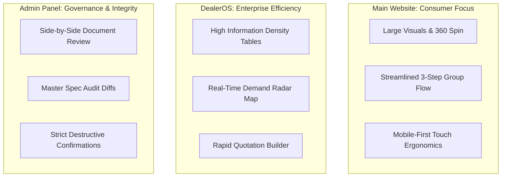

# GroupDrive – Product Design System & UI/UX Guidelines

**Document Version:** 1.0.0  
**Status:** Approved Design Baseline  
**Classification:** Confidential & Proprietary – GroupDrive Technologies  
**Target Applications:** Main Website (`groupdrive.in`), DealerOS (`dealer.groupdrive.in`), Admin Panel (`admin.groupdrive.in`)  
**Component Architecture:** React + TypeScript + Tailwind CSS + shadcn/ui + Lucide Icons  
**Date:** November 2026  

---

## 1. Brand Identity & Design Philosophy

The GroupDrive visual identity embodies **Precision, Authority, Velocity, and Transparency**.

- **Main Website (`groupdrive.in`):** An aspirational, high-trust automotive marketplace. Emphasizes immersive vehicle imagery, intuitive search ergonomics, transparent pricing breakdowns, and frictionless collective buying.
- **DealerOS (`dealer.groupdrive.in`):** A high-density, professional enterprise SaaS workstation. Optimized for rapid inventory scanning, demand radar visualization, quotation generation, and SLA monitoring.
- **Admin Panel (`admin.groupdrive.in`):** A high-contrast, structured governance console. Prioritizes data verification workflows, catalogue curation integrity, and immutable audit visibility.

---

## 2. Proposed Colour Tokens & Palettes

All colors are defined as HSL tokens for seamless CSS variable theme switching.

```
┌────────────────────────────────────────────────────────────────────────┐
│                              THEME TOKENS                              │
├──────────────────┬──────────────────────┬──────────────────────────────┤
│ Token Name       │ Light Mode (Hex)     │ Dark Mode (Hex)              │
├──────────────────┼──────────────────────┼──────────────────────────────┤
│ Brand Primary    │ Deep Navy (#0F172A)  │ Electric Cobalt (#38BDF8)    │
│ Brand Accent     │ Racing Red (#E11D48) │ Vivid Crimson (#F43F5E)      │
│ Brand Secondary  │ Slate Blue (#475569) │ Muted Slate (#94A3B8)        │
│ Background       │ Pure White (#FFFFFF) │ Obsidian Carbon (#0B0F17)    │
│ Card Surface     │ Off-White (#F8FAFC)  │ Dark Slate Card (#1E293B)    │
│ Border / Divider │ Soft Grey (#E2E8F0)  │ Subtle Charcoal (#334155)    │
├──────────────────┼──────────────────────┼──────────────────────────────┤
│ Success          │ Emerald (#10B981)    │ Mint Green (#34D399)         │
│ Warning          │ Amber Gold (#F59E0B) │ Solar Yellow (#FBBF24)       │
│ Destructive      │ Carmine Red (#DC2626)│ Rose Red (#F87171)           │
│ Informational    │ Royal Blue (#2563EB) │ Sky Blue (#60A5FA)           │
└──────────────────┴──────────────────────┴──────────────────────────────┘
```

---

## 3. Typography Scale & Hierarchy

**Font Family:** `Inter`, `Plus Jakarta Sans`, or `Geist Sans` with fallback to `system-ui, -apple-system, BlinkMacSystemFont`.

| Style Level | Font Size (rem / px) | Line Height | Font Weight | Tracking | Primary Usage |
|---|---|---|---|---|---|
| **Display 1** | `3.5rem` (56px) | 1.1 | Bold (700) | `-0.025em` | Hero landing headlines |
| **Heading 1** | `2.25rem` (36px) | 1.2 | Bold (700) | `-0.02em` | Model name on VDP, Dashboard titles |
| **Heading 2** | `1.75rem` (28px) | 1.25 | SemiBold (600) | `-0.015em` | Section headers, Group titles |
| **Heading 3** | `1.25rem` (20px) | 1.4 | SemiBold (600) | `-0.01em` | Card titles, Modal headers |
| **Body Large** | `1.125rem` (18px)| 1.5 | Regular (400) | `0em` | Editorial lead paragraphs |
| **Body Default**| `1.0rem` (16px)  | 1.5 | Regular (400) | `0em` | Standard interface copy, inputs |
| **Body Small**  | `0.875rem` (14px)| 1.4 | Medium (500) | `0em` | Table data cells, secondary labels |
| **Micro Caption**| `0.75rem` (12px)| 1.3 | SemiBold (600) | `+0.02em` | Status badges, timestamps, tags |

---

## 4. Spacing, Grid & Elevation

- **Base Unit:** 4px scale (`p-1` = 4px, `p-2` = 8px, `p-4` = 16px, `p-6` = 24px, `p-8` = 32px, `p-12` = 48px).
- **Responsive Breakpoints:**
  - `sm`: `640px` (Mobile landscape)
  - `md`: `768px` (Tablets / Foldables)
  - `lg`: `1024px` (Small laptops / Desktop standard)
  - `xl`: `1280px` (Widescreen monitors)
  - `2xl`: `1536px` (Ultra-wide displays)
- **Container Max-Widths:** Main Website: `max-w-7xl` (1280px); DealerOS & Admin: Fluid full-width (`w-full px-6`).
- **Elevation Shadows:**
  - `shadow-sm`: Flat cards, borders.
  - `shadow-md`: Hovered vehicle cards, dropdown menus.
  - `shadow-lg`: Sticky quotation summary drawers, navigation bars.
  - `shadow-xl`: Modal dialogs, 360° spin fullscreen overlays.

---

## 5. Core UI Primitives & Design System Components

All components are implemented in `packages/ui` based on unstyled Radix UI primitives with Tailwind styling.

### 5.1 Buttons
- **Primary Action (`Button variant="default"`):** High-contrast filled button (Deep Navy in light mode, Racing Red for primary conversion CTAs like "Join Group").
- **Secondary Action (`Button variant="secondary"`):** Subtle filled background for secondary actions ("Configure EMI", "Download Brochure").
- **Outline (`Button variant="outline"`):** 1px border with transparent background for filters and variant toggles.
- **Destructive (`Button variant="destructive"`):** Carmine Red for "Leave Group", "Cancel Campaign", "Reject Dealer KYC".
- **Loading State:** Auto-disables and displays a spinning `Loader2` Lucide icon with accessible `aria-busy="true"`.

### 5.2 Form Inputs & Controls
- **Floating Label Inputs:** Accessible form fields with integrated error messaging (`aria-invalid="true"`).
- **Multi-Select Comboboxes:** For vehicle feature filtering and RTO jurisdiction selection.
- **Price Range Dual-Sliders:** Smooth dual-thumb sliders for budget filtering (₹5L to ₹50L).

### 5.3 Specialized Automotive Cards
1. **Vehicle Showcase Card (Marketplace):**
   - High-res vehicle render with aspect ratio `16:9`.
   - Brand logo badge & Bharat NCAP star rating indicator.
   - Price band display: "₹11.20L – ₹15.80L Ex-Showroom".
   - Active Group Tag: "3 Groups Active in Bengaluru".
   - "Compare" checkbox & "Explore" CTA.
2. **Collective Buying Group Card:**
   - Model name, city badge, and target delivery timeframe.
   - Circular capacity progress indicator (e.g., "7/10 Members").
   - Potential savings banner (e.g., "Estimated Group Saving: ₹45,000+").
   - Expiry countdown timer badge.
3. **Itemized Quotation Comparison Card:**
   - Dealership franchise badge & verification shield.
   - Itemized table with collapsible breakdown (Ex-showroom, RTO, Insurance, Net Group Discount).
   - Delivery commitment timeline.
   - Prominent "Accept Offer & Lock Deal" button.

---

## 6. Application-Specific Experience Guidelines



### 6.1 Main Website (`groupdrive.in`)
- **Layout:** Centered container, clean white space, high-impact photography.
- **Navigation:** Persistent sticky header with quick city selector, global search bar, and Wishlist badge.
- **Interactivity:** 60fps gesture-based 360° spin viewer; animated score meter for vehicle matchmaker.

### 6.2 DealerOS (`dealer.groupdrive.in`)
- **Layout:** Collapsible left sidebar navigation, top notification bar with real-time lead alerts.
- **Data Tables:** Dense tabular rows (36px row height) with sticky headers, column reordering, export to Excel, and inline status dropdowns.
- **Workstations:** Split-pane quotation builder allowing sales managers to view group variant breakdown on the left while calculating itemized margins on the right.

### 6.3 Admin Panel (`admin.groupdrive.in`)
- **Layout:** High-contrast sidebar, breadcrumb hierarchy, prominent environment badge ("PRODUCTION").
- **Verification UI:** Split-screen layout displaying uploaded dealer trade certificates / GSTIN PDFs on the left alongside editable form fields and verification action buttons on the right.

---

## 7. State Visualization & Feedback Conventions

1. **Loading States:** Shimmer skeletons matching the exact geometry of destination cards (zero layout shifts).
2. **Empty States:** Branded vector illustrations with clear actionable advice (e.g., "No active groups found in Pune. Be the first to start a Tata Nexon group and invite friends!").
3. **Error Feedback:** Inline field validation errors + global toast notifications (via `sonner`) for network failures.
4. **Success Feedback:** Animated checkmark modal for group joins with instant calendar invite download and WhatsApp share link.

---

## 8. Accessibility & Compliance Standards

- **WCAG 2.1 Level AA Compliance:** Minimum 4.5:1 contrast ratio for normal text; 3:1 for large display text.
- **Keyboard Navigation:** Full tab-index traversal across comparison tables, filters, and modal dialogs.
- **Screen Reader Support:** Semantic HTML5 elements (`<main>`, `<article>`, `<section>`, `<nav>`) with descriptive `aria-label` tags for all interactive icons and status badges.

