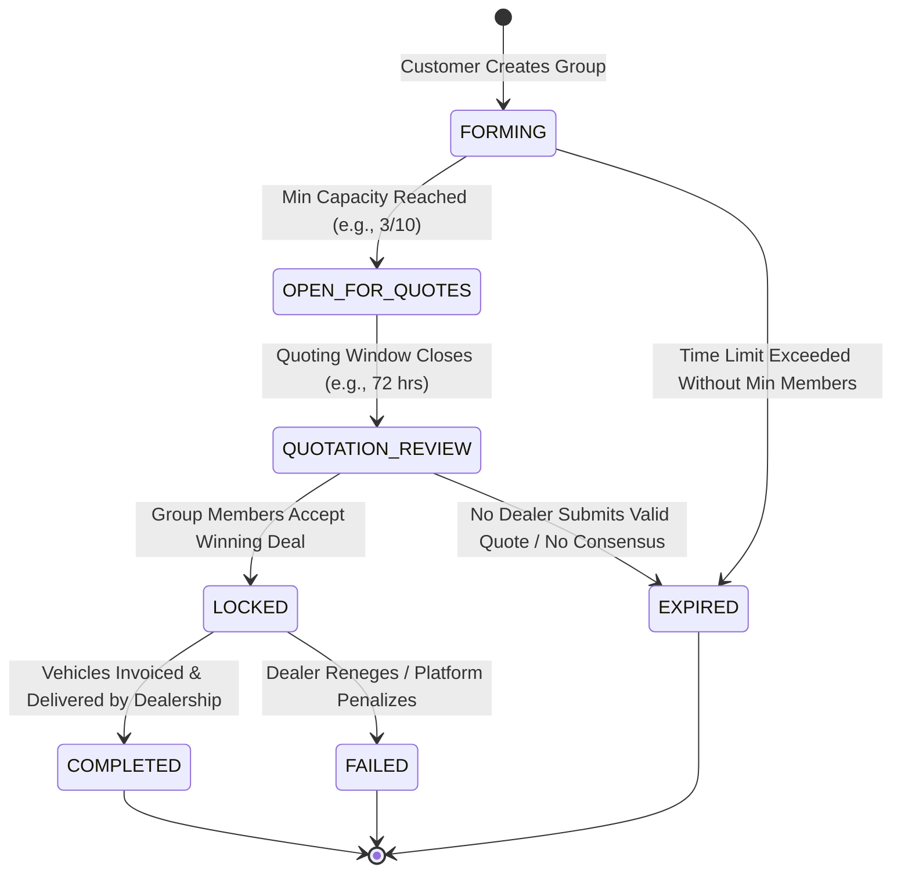

# GroupDrive – Product Requirements Document (PRD)

**Document Version:** 1.0.0
**Status:** Approved Architectural Baseline
**Classification:** Confidential & Proprietary – GroupDrive Technologies
**Target Market:** India (Initial Focus: New Passenger Vehicles)
**Date:** November 2026

---

## 1. Executive Summary

**GroupDrive** is an automotive technology and commerce platform engineered to redefine the new passenger vehicle acquisition lifecycle in India. By bridging the structural gap between fragmented consumer demand and authorized automotive dealerships, GroupDrive delivers an integrated ecosystem consisting of:

1. **Customer Marketplace (`groupdrive.in`):** An AI-assisted discovery, multi-attribute deterministic comparison, interactive 360° visualization, and collective purchasing platform.
2. **DealerOS (`dealer.groupdrive.in`):** An enterprise-grade dealership management and demand intelligence SaaS enabling authorized dealers to tap aggregated high-intent buyer pools, launch targeted sales campaigns, manage branch inventory, and submit binding itemized quotations.
3. **Admin Panel (`admin.groupdrive.in`):** A centralized governance platform maintaining the master Indian vehicle catalogue, dealer KYC verification, platform auditability, and campaign oversight.

Traditional Indian car buying is plagued by opaque on-road pricing, aggressive retail haggling, fragmented dealership visits, and asymmetric information. Dealerships simultaneously face escalating customer acquisition costs (CAC), declining showroom walk-ins, and inventory holding penalties. GroupDrive resolves this dual-sided market inefficiency through **Group Purchasing (Collective Buying)** and **Intelligent Reverse Quotations**, allowing clustered consumers to leverage collective bargaining power while offering dealers bulk retail velocity without public brand devaluation.

---

## 2. Product Vision

To become India’s definitive automotive operating ecosystem where every vehicle purchase is transparent, data-driven, collective, and friction-free—connecting millions of buyers with authorized dealer networks through verified data, deterministic intelligence, and collective volume economics.

**Tagline:** *Discover. Compare. Group. Negotiate. Drive.*

---

## 3. Product Mission

- **Democratize Pricing Transparency:** Eliminate predatory markups and opaque pricing components (handling charges, mandatory inflated insurance, unsolicited dealer add-ons).
- **Amplify Consumer Leverage:** Enable retail buyers to pool demand across geographic and model clusters to achieve volume-tier pricing traditionally reserved for institutional fleets.
- **Optimize Dealership Efficiency:** Provide dealership principals and sales teams with qualified, verified, high-intent buyer clusters with quantifiable delivery windows, reducing customer acquisition costs by over 40%.
- **Ensure Uncompromising Truth:** Deliver a centrally curated, manufacturer-grade vehicle specification and variant catalogue that eliminates misinformation and AI hallucinations.

---

## 4. Product Positioning

```
                         High Price Transparency
                                    │
                                    │       ★ GROUPDRIVE
                                    │    (Discovery + Collective
                                    │     Buying + DealerOS SaaS)
                                    │
            Traditional Aggregators │
            (CarWale, CarDekho)     │
            - Lead generation only  │
            - Opaque dealer pricing │
                                    │
    Low Automation ─────────────────┼───────────────── High Automation
                                    │
                                    │   OEM Direct-to-Consumer
                                    │   (Tesla, Tata.ev direct)
                                    │   - Fixed price, single brand
                                    │   - No collective bargaining
                                    │
                         Low Price Transparency
```

GroupDrive does not position itself as a traditional lead-generation directory (which sells user contact details to 10 competing dealerships). GroupDrive positions itself as a **Transactional Demand Aggregator and SaaS Platform** that protects customer privacy until verified quotations are accepted.

---

## 5. Problem Statement

### 5.1 The Consumer Dilemma (India)

1. **Opaque On-Road Price Inflation:** Ex-showroom prices are standard, but dealerships arbitrarily inflate on-road costs through non-statutory logistics charges, overpriced proprietary insurance bundles, and mandatory accessory packages.
2. **Exhausting Asymmetric Negotiation:** Individual retail buyers lack leverage. Securing a competitive deal requires physically visiting 4 to 8 dealership showrooms across metropolitan regions over several weekends.
3. **Information Overload and Specification Drift:** Modern cars in India feature dozens of confusing trims, safety packages, engine-gearbox combinations, and real-world compliance criteria (BS6 Phase 2, E20 fuel readiness, RDE norms, Bharat NCAP ratings). Buyers struggle to evaluate what genuinely matches their needs.
4. **Lead Spam & Privacy Violations:** Submitting an enquiry on conventional auto portals triggers relentless cold calling from tele-callers and multiple competing dealerships.

### 5.2 The Dealership Challenge

1. **Skyrocketing Cost of Customer Acquisition (CAC):** Digital leads purchased from conventional aggregators have conversion rates below 2-3%, forcing dealers to spend heavily on aggressive tele-calling and floor staff follow-ups.
2. **Inventory Holding & Aging Costs:** Carrying floor plan financing for slow-moving variants or aging inventory creates severe working capital drag.
3. **Margin Erosion from Random Discounting:** Ad-hoc floor discounts offered to combative walk-in customers erode profitability without guaranteeing target sales quotas.
4. **Lack of Demand Visibility:** Dealerships cannot accurately forecast regional consumer preference for specific fuel types (Petrol vs. Hybrid vs. EV) or transmission variants before allocating inventory.

---

## 6. Market and Target Audience

### 6.1 Geographic Focus

- **Phase 1 (MVP Launch):** Tier-1 Metropolitan Hubs: Delhi-NCR, Mumbai Metropolitan Region (MMR), Bengaluru, Hyderabad, Chennai, and Pune.
- **Phase 2 Expansion:** Tier-2 Automotive Growth Clusters: Ahmedabad, Surat, Jaipur, Lucknow, Chandigarh Tricity, Kochi, Coimbatore, and Indore.
- **Phase 3 Nationwide:** All State Capitals and Tier-3 regional district clusters.

### 6.2 Target Vehicle Segments (Initial)

- Sub-4m Compact SUVs (e.g., Tata Nexon, Maruti Brezza, Hyundai Venue, Kia Sonet).
- Mid-size SUVs (e.g., Hyundai Creta, Kia Seltos, Maruti Grand Vitara, Mahindra Scorpio-N, Tata Harrier).
- Premium & Compact Hatchbacks (e.g., Maruti Swift/Baleno, Hyundai i20, Tata Altroz).
- Mid-size Sedans (e.g., Honda City, Hyundai Verna, Skoda Slavia, Volkswagen Virtus).

---

## 7. User Personas

| Persona ID       | Name & Profile                                                                                         | Primary Goals                                                                                             | Key Pain Points                                                                                         | Platform Touchpoints                                                         |
| ---------------- | ------------------------------------------------------------------------------------------------------ | --------------------------------------------------------------------------------------------------------- | ------------------------------------------------------------------------------------------------------- | ---------------------------------------------------------------------------- |
| **PER-01** | **Aarav (Value Maximizer)**Age 32, Tech Professional, Bengaluru. First-time SUV buyer.           | Find best safety & fuel economy within ₹14L on-road; obtain transparent group discounts.                 | Confused by 18 variants of the same SUV; hates unsolicited sales calls and dealer haggling.             | Main Website: Smart Comparison, Group Joining, Quotation Comparison.         |
| **PER-02** | **Priya (Family Upgrader)**Age 41, Entrepreneur, Pune. Upgrading from hatchback to 7-seater.     | Needs 6+ airbags, automatic transmission, ventilated seats, reliable boot space.                          | Cannot visualize real boot capacity or seat folding; dealership salespeople give conflicting answers.   | Main Website: 360° Interior Viewer, AI Assistant, Group Creation.           |
| **PER-03** | **Vikram (Dealer Principal)**Age 52, Multi-branch Dealership Owner, Delhi-NCR.                   | Clear 35 units of aging inventory before quarter end; acquire qualified buyer batches.                    | Bleeding money on digital ad leads with 1.8% conversion; sales staff wasting hours on unverified leads. | DealerOS: Demand Intelligence, Campaign Manager, Branch Allocation.          |
| **PER-04** | **Rajesh (Branch Sales Manager)**Age 38, Dealership Branch Manager, Mumbai.                      | Hit monthly sales target; assign hot group leads to executives; track gross margin per vehicle.           | Price war with neighboring dealer; difficult to coordinate group quotation approvals quickly.           | DealerOS: Quotation Builder, Executive Assignment, Negotiation Dashboard.    |
| **PER-05** | **Sunita (Platform Administrator)**Age 29, GroupDrive Head of Dealer Verification & Master Data. | Maintain pristine catalogue integrity; verify dealer trade licenses and GST registrations; monitor fraud. | Inconsistent OEM variant nomenclatures; dealers attempting to submit bait-and-switch quotes.            | Admin Panel: Master Catalogue Manager, Dealer KYC Verification, Audit Trail. |

---

## 8. Customer Pain Points & Product Remedies

| Traditional Customer Pain Point                                    | GroupDrive Engineering Remedy                                                                                                                                  |
| ------------------------------------------------------------------ | -------------------------------------------------------------------------------------------------------------------------------------------------------------- |
| Hidden charges added to dealer quotation (handling/logistics fee). | Itemized, mandatory quotation schema enforcing separation of statutory vs. optional costs. Handling charges flagged as illegal per Indian judicial precedents. |
| Individual buyer has zero negotiating power.                       | Group Purchasing Engine aggregating 3 to 20 verified buyers to trigger bulk commercial discounts.                                                              |
| Overwhelmed by 30+ variants per model.                             | Deterministic Feature Differencer highlighting true specification delta between trims.                                                                         |
| Phone number sold to dozens of aggressive telecallers.             | Strict Zero-Spam Architecture: Customer contact info is masked until customer formally selects and locks a dealer quote.                                       |
| High-pressure tactics to buy overpriced dealer insurance.          | Mandatory separation of insurance: System allows comparison with standardized IRDAI-compliant insurance quotes.                                                |

---

## 9. Dealer Pain Points & Product Remedies

| Traditional Dealer Pain Point                            | GroupDrive Engineering Remedy                                                                                     |
| -------------------------------------------------------- | ----------------------------------------------------------------------------------------------------------------- |
| Lead quality is dismal (<3% conversion rate).            | Pre-verified, OTP-authenticated buyers with locked variant preferences, financing status, and delivery deadlines. |
| Inventory holding costs on specific trim/colour batches. | Targeted "Flash Campaigns" allowing dealers to target specific groups matching existing yard stock.               |
| Public brand discounting attracts OEM penalties.         | Closed-group private bidding: Group discounts are private to group members and never indexed publicly.            |
| Multi-branch coordination chaos.                         | DealerOS multi-branch hierarchy allowing group allocations to the nearest authorized stockyard or showroom.       |

---

## 10. Platform Overview & Unified Ecosystem

GroupDrive operates as an integrated triple-application ecosystem sharing a single database, unified authentication, centralized vehicle master catalogue, and shared backend domain services.

```
                  ┌─────────────────────────────────────────────────────────┐
                  │                 GROUPDRIVE BACKEND CORE                 │
                  │   FastAPI Modular Monolith | PostgreSQL | Redis/Celery   │
                  └────────────▲────────────────▲────────────────▲──────────┘
                               │                │                │
            ┌──────────────────┴──┐   ┌─────────┴─────────┐   ┌──┴──────────────────┐
            │                     │   │                   │   │                     │
  ┌─────────┴──────────┐   ┌──────┴───┴─────────┐   ┌─────┴──────────────┐   ┌──────┴──────────────┐
  │    Main Website    │   │      DealerOS      │   │    Admin Panel     │   │   Shared AI Core    │
  │  (groupdrive.in)   │   │(dealer.groupdrive) │   │ (admin.groupdrive) │   │   (Google Gemini)   │
  │ Customer Discovery │   │ Dealer Management  │   │ Platform Governance│   │ Analysis & Reasoning│
  │   Group Buying     │   │ Campaign & Quotes  │   │ Catalogue Master   │   │ (Deterministic Core)│
  └────────────────────┘   └────────────────────┘   └────────────────────┘   └─────────────────────┘
```

---

## 11. Application Structure

### 11.1 Main Website (`groupdrive.in`)

- **Target Audience:** Car buyers, group organizers, automotive researchers.
- **Primary Modules:** Home Portal, Dynamic Catalogue & Advanced Filters, Vehicle Detail Page (VDP), Interactive 360° Spin Viewer, Smart Comparison Engine, Personalized Scoring Engine, Group Purchasing Hub, My Quotes & Booking Dashboard, User Profile & Preferences.

### 11.2 DealerOS (`dealer.groupdrive.in`)

- **Target Audience:** Dealership Owners, General Managers, Branch Managers, Sales Executives, Inventory Controllers.
- **Primary Modules:** Dealer Dashboard, Branch Management, Staff & Role Management, Inventory Management & Stockyard Tracker, Regional Demand Dashboard (Aggregated Buyer Needs), Flash Campaign Builder, Quotation Engine (Itemized On-Road Quote Generator), Customer Enquiry & Lead Pipeline, Performance Analytics & SLA Tracker.

### 11.3 Admin Panel (`admin.groupdrive.in`)

- **Target Audience:** Platform Super Admins, Catalogue Curators, Dealer Verification Officers, Compliance Auditors.
- **Primary Modules:** Global Analytics Cockpit, Dealer Onboarding & KYC Approval, Master Vehicle Catalogue (Brands, Models, Variants, Specifications, Colours, Media), Group Purchasing Oversight, Campaign & Quotation Moderation, Platform Fee & Transaction Auditing, System Logs & Security Dashboard.

---

## 12. Main Website Functional Requirements

| ID               | Feature Name                              | Priority | Description & Business Rules                                                                                                                                                                                                                                                                        | Acceptance Criteria                                                                                                                             |
| ---------------- | ----------------------------------------- | -------- | --------------------------------------------------------------------------------------------------------------------------------------------------------------------------------------------------------------------------------------------------------------------------------------------------- | ----------------------------------------------------------------------------------------------------------------------------------------------- |
| **WEB-01** | **Multi-Faceted Search & Filter**   | P0       | Filter by Price Range (₹ Lakhs), Body Type (SUV, Sedan, Hatchback, MUV), Fuel Type (Petrol, Diesel, Strong Hybrid, CNG, Electric), Transmission (Manual, iMT, AT, Torque Converter, Dual-Clutch DCT, CVT), Safety Rating (Bharat NCAP / Global NCAP 1-5 Stars), Seating Capacity (5, 6, 7-seater). | Instant filtering (<150ms via client-side/Redis cache); URL parameters update dynamically for shareable search states.                          |
| **WEB-02** | **Vehicle Detail Page (VDP)**       | P0       | Comprehensive view of vehicle: Ex-showroom price, indicative RTO and Insurance by state/city, photo gallery, 360° spin viewer, variant switcher, standard features vs. optional accessories, real-world mileage indicators, technical specifications table.                                        | Zero missing data for active models; state-aware on-road indicative calculator based on user pin code.                                          |
| **WEB-03** | **Interactive 360° Viewer**        | P1       | Interactive 24/36-frame exterior orbital spin viewer with touch/drag controls, zoom capability, and colour-variant switcher. High-end WebGL/Three.js interior 360° panoramic view for select models.                                                                                               | Smooth 60fps rotation on mobile and desktop; progressive image loading with low-res blurhash placeholders.                                      |
| **WEB-04** | **Smart Comparison Engine**         | P0       | Side-by-side comparison of 2 to 4 vehicle variants. Deterministic delta computation highlighting differences in safety, powertrain, dimensions, comfort, and ownership costs.                                                                                                                       | Identical specifications automatically collapsible; differences highlighted with green/neutral indicators; printable/shareable comparison link. |
| **WEB-05** | **Personalized Vehicle Matchmaker** | P1       | Questionnaire-driven recommendation algorithm (Budget, Monthly KM, Commute Type, Family Size, Driving Style) outputting a deterministic compatibility score (0-100%) with explanatory rationale powered by Gemini.                                                                                  | Deterministic scoring calculation executed on backend; AI generates human-readable narrative explaining *why* the car fits the lifestyle.     |
| **WEB-06** | **Group Purchasing Portal**         | P0       | Discovery feed of active regional groups (e.g., "Tata Harrier/Safari Bangalore Group - Oct Batch"). Ability to view target discount, current members, remaining slots, countdown timer, and verified participating dealerships.                                                                     | Clear display of group stage, capacity meter (e.g., "7/10 Members Joined"), minimum commitment terms, and rules.                                |
| **WEB-07** | **Group Creation Workflow**         | P0       | Verified customer creates a collective buying group by selecting: Target Model/Variant, Target City/Region, Buying Timeline (Immediate <15 days, 30 days, 45 days), Target Member Size (Min 3, Max 15).                                                                                             | User must be phone-OTP verified; group enters `PENDING_REVIEW` or auto-activates if criteria met. Creator designated as Group Lead.           |
| **WEB-08** | **Group Join & Lock Workflow**      | P0       | Customer joins an active group by verifying city proximity (same RTO zone/district) and selecting their exact variant and preferred colour. Customer signs digital intent.                                                                                                                          | Prevents joining if user's location is incompatible with group dealership delivery jurisdiction. Capacity checked atomically.                   |
| **WEB-09** | **Customer Quotation Comparison**   | P0       | Side-by-side comparison of binding quotations submitted by competing authorized dealers for the group. Breakdowns detail Ex-showroom, RTO, Insurance, Fastag, Accessory package, and Net Group Discount.                                                                                            | Best offer highlighted; calculation verified against statutory RTO formula; dealer identity revealed with rating.                               |
| **WEB-10** | **Deal Acceptance & Booking Lock**  | P0       | Customer accepts the winning quotation, generating a tamper-proof Group Booking Token. Customer proceeds to connect with the winning dealership for paperwork/test drive.                                                                                                                           | Timestamped lock preventing dealer from reneging on quote; digital voucher generated with unique hash.                                          |

---

## 13. DealerOS Functional Requirements

| ID               | Feature Name                                     | Priority | Description & Business Rules                                                                                                                                                                                                                                            | Acceptance Criteria                                                                                                   |
| ---------------- | ------------------------------------------------ | -------- | ----------------------------------------------------------------------------------------------------------------------------------------------------------------------------------------------------------------------------------------------------------------------- | --------------------------------------------------------------------------------------------------------------------- |
| **DOS-01** | **Dealership Onboarding & KYC**            | P0       | Dealership registration submitting Legal Entity Name, OEM Franchise Authorization Certificate, GSTIN, PAN, Registered Office, Showroom & Yard Addresses, and Bank Details.                                                                                              | Uploads verified via Admin Panel. Dealership cannot submit quotations until KYC state is `VERIFIED`.                |
| **DOS-02** | **Multi-Branch Hierarchy**                 | P0       | Dealer Owner can add multiple showroom branches and stockyards within their assigned regional territory. Assign Branch Managers and Sales Executives to specific locations.                                                                                             | Strict RBAC isolation: Branch staff can only access inquiries and inventory assigned to their specific branch.        |
| **DOS-03** | **Inventory & Yard Management**            | P1       | Track available and in-transit vehicles by VIN/Stock ID, Model, Variant, Colour, Fuel, Manufacturing Month/Year, and Physical Location. Mark units as "Available for Group Flash Sale".                                                                                 | Prevents double-booking of physical VINs; supports bulk CSV/Excel import of stock sheets.                             |
| **DOS-04** | **Regional Demand Dashboard**              | P0       | Real-time map and list view of active consumer groups within the dealership's authorized geographical territory (e.g., "12 buyers in Gurugram seeking Hyundai Creta SX(O) Petrol IVT within 30 days").                                                                  | Anonymized view of buyer groups; shows aggregate volume, variant split, and countdown to quotation deadline.          |
| **DOS-05** | **Flash Campaign Builder**                 | P1       | Dealership creates time-bound promotional campaigns offering specific discount bands for targeted groups or volume thresholds (e.g., "Flat ₹45,000 corporate cash discount + 3yr extended warranty for groups of 5+").                                                 | Campaign parameters validated against minimum gross margin thresholds; scheduled start and end triggers.              |
| **DOS-06** | **Itemized Quotation Generator**           | P0       | Formal quotation tool generating standardized price sheets. Enforces separate line items for: (1) Ex-Showroom, (2) State RTO Tax, (3) Mandatory Insurance vs. Optional Add-ons, (4) FASTag, (5) Hypothecation Fee, (6) Standard Accessories, (7) Group Volume Discount. | Non-statutory charges (handling/logistics) blocked by validation rule; net on-road price mathematically validated.    |
| **DOS-07** | **Group Bid Submission & Reverse Auction** | P0       | Dealership submits a binding group bid to an active buyer group before the deadline. Can revise quote downwards if outbid during open bidding window.                                                                                                                   | Quotes submitted are legally binding for 14 calendar days; automated notification sent to group members upon receipt. |
| **DOS-08** | **Lead Allocation & Sales Pipeline**       | P1       | Once a group accepts a quotation, full customer details (Name, Contact, Location, Variant choice) are unmasked and injected into the branch's CRM lead pipeline. Assigned to Sales Executives with SLA tracking.                                                        | Audit log records timestamp of contact unmasking; executives receive in-app and WhatsApp notifications.               |
| **DOS-09** | **Dealership Analytics & Benchmarking**    | P2       | Analytics on Win Rate per Model, Average Discount vs. Market Velocity, Competitor Pricing Trends (Anonymized), Inventory Days-on-Lot Reduction.                                                                                                                         | Interactive charts powered by Chart.js/Recharts; daily and monthly reporting views.                                   |

---

## 14. Admin Panel Functional Requirements

| ID               | Feature Name                                    | Priority | Description & Business Rules                                                                                                                                                    | Acceptance Criteria                                                                                                                     |
| ---------------- | ----------------------------------------------- | -------- | ------------------------------------------------------------------------------------------------------------------------------------------------------------------------------- | --------------------------------------------------------------------------------------------------------------------------------------- |
| **ADM-01** | **Master Vehicle Catalogue Manager**      | P0       | Full CRUD management of Automotive Brands, Models, Trims, Variants, Dimensions, Engine/Transmission Specs, Safety Ratings, Official Colours, and Ex-Showroom Pricing per State. | Only Super Admins and Catalogue Admins can modify master specs; changes version-tracked in audit logs. Dealers cannot edit master data. |
| **ADM-02** | **Dealer Verification & Compliance**      | P0       | Verification queue for pending dealer applications. Inspect GSTIN authenticity, verify OEM dealership franchise agreements, approve or reject with audit notes.                 | Rejection mandates an explicit reason code; approval automatically activates DealerOS access and generates welcome credentials.         |
| **ADM-03** | **Group Lifecycle Monitoring**            | P0       | Platform-wide oversight of all active, quoting, locked, and completed groups. Flag anomalous group behavior, spam accounts, or artificial volume manipulation.                  | Admin can extend deadlines, cancel fraudulent groups, or arbitrate disputes between buyers and dealerships.                             |
| **ADM-04** | **Quotation Moderation & Price Auditing** | P0       | Automated and manual screening of dealer quotations. AI and regex scanners identify disguised handling fees, hidden markups, or predatory insurance terms.                      | Flagged quotations quarantined; dealer given 12 hours to rectify or face quotation cancellation and compliance strike.                  |
| **ADM-05** | **Platform Fee & Billing Engine**         | P1       | Track platform commissions or dealer subscription billings. Calculate success fees per converted group vehicle, generate GST-compliant invoices.                                | Automated tax invoicing (SAC code 9983); monthly statement generation for dealership accounts.                                          |
| **ADM-06** | **Audit Trail & System Security Logs**    | P0       | Immutable logging of all sensitive administrative actions, user permission changes, dealer status updates, quotation approvals, and data exports.                               | Logs structured in JSON format with actor ID, IP address, timestamp, and before/after state diffs.                                      |

---

## 15. AI Functional Requirements

| ID              | Feature Name                                                | Priority | Architectural Implementation & Guardrails                                                                                                                                                                                                                                                                                                       |
| --------------- | ----------------------------------------------------------- | -------- | ----------------------------------------------------------------------------------------------------------------------------------------------------------------------------------------------------------------------------------------------------------------------------------------------------------------------------------------------- |
| **AI-01** | **Deterministic Comparison Engine**                   | P0       | Pure backend deterministic algorithm calculating exact differences across 120+ structured vehicle attributes. **Zero LLM hallucination risk.**                                                                                                                                                                                            |
| **AI-02** | **AI Comparison Explainer**                           | P1       | Google Gemini API receives the structured deterministic diff output as JSON and generates natural-language prose summarizing key trade-offs tailored to Indian buyer personas (e.g., "Creta SX provides panoramic sunroof and rear disc brakes over Seltos HTX, but Seltos offers firmer highway handling and standard all-wheel disc brakes"). |
| **AI-03** | **AI Quotation Document Analyzer (OCR + Extraction)** | P1       | Multimodal Gemini API processes scanned physical dealer quotation sheets or PDFs uploaded by users. Extracts itemized components into structured JSON schema to verify against official rates.                                                                                                                                                  |
| **AI-04** | **Intelligent Buyer Group Matcher**                   | P1       | Clustering algorithm grouping individual unattached enquiries into optimal regional groups based on pin code distance, budget band, model synergy, and target delivery timeframe.                                                                                                                                                               |
| **AI-05** | **Dealership Demand Forecasting Intelligence**        | P2       | Aggregates search signals, wishlist additions, and group formation trends to present predictive demand heatmaps to dealers inside DealerOS.                                                                                                                                                                                                     |

---

## 16. Vehicle Catalogue Requirements

### 16.1 Hierarchy & Data Model

```
[Brand / OEM] (e.g., Tata Motors, Hyundai, Mahindra)
      └── [Vehicle Model] (e.g., Nexon, Creta, XUV700)
            └── [Trim / Series] (e.g., Smart, Pure, Creative, Fearless)
                  └── [Vehicle Variant] (e.g., Creative Plus 1.2 Turbo Petrol 6MT)
                        ├── Engine & Transmission Specs (Displacement, Power, Torque, Gearbox)
                        ├── Dimension Specs (Length, Width, Height, Ground Clearance, Boot)
                        ├── Safety & Compliance (Bharat NCAP, Airbag Count, ESP, ADAS Level)
                        ├── Comfort, Convenience & Infotainment (Sunroof, Touchscreen, Audio)
                        ├── Colour Options (Single-tone, Dual-tone, HEX codes, Swatches)
                        └── Pricing Data (Ex-Showroom Base, State GST, Compensation Cess)
```

### 16.2 Strict Governance

- **Central Authority:** The Master Vehicle Catalogue is strictly controlled by Platform Super Admins.
- **Dealer Restrictions:** Dealerships select available variants from the Master Catalogue for their inventory; they have **zero permission** to modify engine power, safety ratings, dimensions, or official trim features.
- **State Pricing Differentiation:** Ex-showroom prices vary marginally across Indian states due to local logistics zones and state-level octroi/entry levies; the catalogue stores state-level ex-showroom pricing matrices.

---

## 17. Vehicle Discovery Requirements

- **Visual Brand Selector:** High-resolution vector logos of all major passenger vehicle manufacturers operating in India.
- **Popular Segment Carousels:** Curated groupings such as *"Top Rated Bharat NCAP 5-Star Safety Cars"*, *"Best Mileage Hybrids & Diesels"*, *"Sub-15 Lakh Automatic SUVs"*, *"Spacious 7-Seaters for Large Families"*.
- **Trending Group Carousels:** Direct discovery of active buyer pools looking for co-buyers with high potential savings.
- **Contextual Search Bar:** Autosuggest supporting fuzzy matching on brand, model, body type, transmission, or natural search queries (e.g., "7 seater diesel automatic under 20 lakhs").

---

## 18. Search and Filter Requirements

### Filter Dimensions

1. **Budget Slider:** ₹5 Lakh to ₹1 Crore with quick presets (Under 10L, 10L-15L, 15L-25L, 25L+).
2. **Body Style:** Hatchback, Compact SUV, Mid-size SUV, Full-size SUV, Compact Sedan, Executive Sedan, MUV/MPV.
3. **Fuel Type:** Petrol, Diesel, CNG (Factory Fitted), Strong Hybrid, Electric (EV).
4. **Transmission:** Manual (MT), Intelligent Manual (iMT), Automated Manual (AMT), Continuous Variable Transmission (CVT), Torque Converter Automatic (AT), Dual Clutch Transmission (DCT/DSG).
5. **Safety Rating:** Bharat NCAP / Global NCAP (5 Stars, 4 Stars, 3 Stars, Unrated).
6. **Key Features Checklist:** 6 Airbags Standard, Electronic Stability Control (ESC), ADAS Level 1/2, Ventilated Seats, Panoramic Sunroof, 360 Camera, Wireless Android Auto/Apple CarPlay, Cruise Control.
7. **Delivery Urgency:** In-stock / Immediate (<14 days), 30 days, 60 days.

---

## 19. Vehicle Detail Page (VDP) Requirements

1. **Header Section:** Brand, Model, Variant Selector dropdown, Ex-Showroom Price, Dynamic On-Road Price Estimator toggleable by City/RTO.
2. **Media Showcase:** High-resolution studio photography gallery, 360° exterior visualizer, colour previewer with real-time body paint shader updates.
3. **Quick Highlights Card:** Engine Displacement, Max Power (BHP), Max Torque (Nm), Fuel Efficiency (ARAI / Real-world), Boot Capacity (Litres), Ground Clearance (Unladen mm).
4. **Active Group Banner:** If an active group exists for this model in the user's city, display prominent card: *"Join 8 buyers in Bengaluru buying this month – Save up to ₹65,000"*.
5. **Detailed Specifications Accordion:** Categorized into Engine & Performance, Dimensions & Weight, Steering & Suspension, Brakes & Tyres, Safety & Security, Doors & Windows, Comfort & Convenience, Lighting & Instrumentation, Entertainment & Connectivity.
6. **Brochure & Spec Sheet:** PDF download of official manufacturer brochure.

---

## 20. 360-Degree Experience Requirements

- **Phase 1 Implementation:** High-fidelity 24 or 36-frame progressive image sequence viewer.
  - Smooth mouse drag and touch swipe rotation.
  - Double-tap / scroll to zoom into wheels, headlights, and badges.
  - Hotspot overlays calling out exterior sensors, ADAS cameras, LED matrix lamps, and sunroof.
- **Phase 2 Implementation:** Three.js / React Three Fiber interactive 3D WebGL model for supported hero models with interior 360° spherical camera pans.
- **Media Optimization:** WebP format, responsive sizes (mobile 720p, desktop 1440p), CDN edge caching.

---

## 21. Smart Comparison Requirements

- **Capacity:** Compare 2 to 4 vehicle variants simultaneously.
- **Categorized Comparison Rows:**
  - *Core Metrics:* Ex-showroom, estimated on-road, monthly fuel cost calculation.
  - *Safety:* NCAP rating, active safety (ESC, TC, ABS, EBD), passive safety (airbag count, ISOFIX), ADAS radar/camera capabilities.
  - *Engine & Dynamics:* Power-to-weight ratio, torque delivery band, transmission responsiveness.
  - *Dimensions & Practicality:* Cabin legroom, boot capacity with seats up/down, turning radius.
  - *Equipment:* Sunroof type, speaker brand, screen size, connected car telematics.
- **"Show Differences Only" Toggle:** Filters out common identical features (e.g., Power Windows, Central Locking) to focus on decision-critical divergence.

---

## 22. Personalized Scoring Requirements

- **Formula Engine:** Deterministic scoring algorithm mapping user priority weights against vehicle attributes:
  $$
  \text{Match Score} = \sum_{i=1}^{n} (w_i \cdot s_i)
  $$

  Where $w_i$ is the normalized user weight for category $i$ (Safety, Economy, Performance, Space, Tech) and $s_i \in [0, 100]$ is the normalized score of the variant in category $i$.
- **Transparency:** System displays the score breakdown radar chart showing exactly how the score was calculated.

---

## 23. AI Recommendation Requirements

- **Trigger:** Initiated when user engages the "Help Me Choose" assistant.
- **Input Pipeline:** User answers 5 conversational questions regarding driving conditions, family structure, budget elasticity, and priority features.
- **Processing:**
  1. Backend runs deterministic filter query against PostgreSQL vehicle database.
  2. Top 3 matching variants extracted with raw specification diffs.
  3. Prompt sent to Google Gemini API containing structured spec data and user profile.
  4. Gemini returns an empathetic, balanced, analytical verdict highlighting strengths and trade-offs.
- **Guardrail:** Gemini is constrained by system prompts to *never* invent features, fuel economy figures, or prices not present in the supplied JSON payload.

---

## 24. Group Purchasing Requirements (Core Differentiator)

```
   [Group Creation] ──► [Member Joining & Pin Code Match] ──► [Threshold Reached (e.g., 5 Buyers)]
                                                                          │
   [Deal Closed & Token] ◄── [Customer Accepts Quote] ◄── [Dealers Bid Reverse Quotes]
```

- **Group Objective:** Aggregate 3 to 15 retail buyers seeking the same model family within the same regional RTO delivery circle.
- **Geographic Boundary:** Group members must share an automotive registration zone (e.g., Delhi-NCR, Mumbai Metropolitan Region) to ensure legal dealership billing feasibility.
- **Variant Flexibility:** Group members can choose different variants and colours of the same vehicle model (e.g., 3 buyers choose Nexon Creative, 2 choose Nexon Fearless), providing dealers with balanced stock movement.

---

## 25. Group Lifecycle and Business Rules



### Business Rules

1. **Minimum Threshold:** A group requires a minimum of 3 verified buyers to transition from `FORMING` to `OPEN_FOR_QUOTES`.
2. **Maximum Capacity:** Groups are capped at 15 members to preserve dealership fulfillment capacity.
3. **Quotation Window:** Authorized dealers within the territory have 72 hours to submit binding proposals.
4. **Quote Binding Window:** Dealership quotes are legally binding for 14 calendar days from submission.
5. **Acceptance Threshold:** At least 60% of active group members must vote to accept a winning quotation for the group to lock.

---

## 26. Dealer Campaign Requirements

- **Campaign Types:**
  - *Volume Flash Discount:* Staged discount tiers (e.g., 3-5 units: ₹30k off; 6-10 units: ₹50k off; 11+ units: ₹70k off).
  - *Aging Stock Clearance:* High discount campaigns targeted at specific VINs or manufacture months older than 60 days.
  - *Accessory & Service Bundles:* Complimentary 5-year extended warranty + ceramic coating packages.
- **Territory Enforcement:** Dealership campaigns are strictly geo-fenced to their OEM-authorized revenue districts.

---

## 27. Buyer Demand Aggregation

- DealerOS aggregates anonymized demand signals into a real-time **Demand Heatmap**.
- Dealerships can view:
  - Total active car buyers in their city searching for their brand.
  - Most sought-after variants and transmissions.
  - Average expected delivery timeframe.
  - Price elasticity curves based on group discount expectations.

---

## 28. Dealer Quotation Management

### 28.1 Mandatory Itemized Quotation Structure

Every quotation submitted via DealerOS must strictly conform to this line-item schema:

```
┌─────────────────────────────────────────────────────────────┐
│ 1. Official Ex-Showroom Price (Standard)                    │
│ 2. State RTO Registration & Road Tax (Statutory)            │
│ 3. Mandatory Comprehensive Motor Insurance (1+3 Years)      │
│ 4. FASTag Issuance Fee (Standard Statutory)                 │
│ 5. TCS (Tax Collected at Source - 1% if Ex-Showroom > ₹10L) │
├─────────────────────────────────────────────────────────────┤
│ SUB-TOTAL: MANDATORY STATUTORY ON-ROAD PRICE                │
├─────────────────────────────────────────────────────────────┤
│ 6. Optional Dealer Accessories Package                      │
│ 7. Optional Extended Warranty / Shield of Trust             │
│ 8. Optional Roadside Assistance (RSA)                       │
├─────────────────────────────────────────────────────────────┤
│ 9. LESS: Manufacturer Consumer Scheme                       │
│ 10. LESS: Corporate / Exchange Bonus (If applicable)        │
│ 11. LESS: GROUPDRIVE EXCLUSIVE VOLUME DISCOUNT              │
├─────────────────────────────────────────────────────────────┤
│ FINAL NET PAYABLE ON-ROAD PRICE                             │
└─────────────────────────────────────────────────────────────┘
```

*Strict Rule:* Any unauthorized "Handling/Logistics/Depot Charges" or "Mandatory Accessory Bundles" will trigger automated rejection of the quotation by the API validation engine.

---

## 29. Quotation Comparison

- Group members view an interactive quotation matrix comparing offers from up to 5 participating dealerships.
- **Transparency Metrics:**
  - True net discount (separated from standard OEM national schemes).
  - Included vs. excluded add-ons.
  - Delivery commitment date (with penalty clause for late delivery).
  - Dealership customer service satisfaction score.

---

## 30. EMI and Finance Requirements

- **Dynamic EMI Calculator:** Real-time loan calculation based on interest rates (7.5% to 12%), tenure (12 to 84 months), and down payment amount.
- **On-Road Financing:** Allows financing calculation based on total on-road price or pure ex-showroom.
- **Financier Integration (Roadmap P2):** Pre-approval lead capture for major automotive lenders in India (SBI Auto Loan, HDFC Bank, ICICI Bank, Kotak Prime).

---

## 31. Notification Requirements

- **Channels:** In-App Notifications, SMS (DLT-compliant Indian templates), WhatsApp Business API, and Transactional Email.
- **Critical Trigger Events:**
  - Group membership milestones ("Only 1 more buyer needed to unlock quotes!").
  - Quotation received from dealership.
  - Quotation window closing in 6 hours.
  - Group deal locked; booking voucher ready.
  - Dealer SLA alert: Unanswered quotation request nearing deadline.

---

## 32. Authentication Requirements

- Unified identity across all three web properties.
- **Customer Auth:** Mobile Number + SMS OTP (Primary for India) and Email/Password with Google OAuth.
- **Dealer Auth:** Corporate Work Email + Secure Password + Two-Factor Authentication (SMS OTP or Authenticator TOTP).
- **Admin Auth:** Hardware-enforced or Strict Multi-Factor Authentication (MFA) + IP allowlisting for Super Admins.
- **Session Strategy:** Stateless JWT access tokens (15-min expiry) with rotating HTTP-only secure refresh tokens (7-day sliding window).

---

## 33. User Account Management

- **Customer Profile:** Saved vehicle shortlists, comparison history, active and past group memberships, accepted quotation vouchers, KYC documents (Aadhaar / Driving License for test drive booking).
- **Dealer Staff Profile:** Assigned branch, assigned role, active leads, quotation quota, sales conversion metrics.

---

## 34. Admin Requirements

- Complete user account suspension and reactivation controls.
- Comprehensive dealer verification approval queue with document previewer.
- Master catalogue management with change staging and rollback capability.
- System health, API latency, and Celery background task monitoring.

---

## 35. Business Model & Monetization

1. **Dealership SaaS Subscription (DealerOS):** Monthly/Annual subscription tiers (Starter, Pro, Enterprise Network) granting access to the regional demand dashboard and campaign builder.
2. **Success Fee Per Delivered Vehicle:** Fixed platform transaction fee (₹2,500 to ₹5,000 per car) paid by the dealership upon successful customer delivery through a group deal.
3. **Featured Dealership Campaigns:** Paid placement for authorized dealers running regional flash sales on the Main Website.
4. **Ancillary Partnerships (Roadmap):** Referral commissions from automotive insurance brokers, non-banking financial companies (NBFCs), and car accessory partners.

---

## 36. Non-Functional Requirements (NFR)

- **Performance:** 95th percentile (P95) API response time $< 200\text{ ms}$ under nominal load.
- **Availability:** $99.9\%$ platform uptime target (excluding scheduled maintenance windows).
- **Scalability:** Horizontal scaling of backend API instances capable of handling 5,000 concurrent active users and 100,000 monthly active users (MAU).
- **Data Integrity:** ACID-compliant relational transactions for group capacity locks and quotation submissions using PostgreSQL serializable transaction isolation.

---

## 37. Security Requirements

- **OWASP Top 10 Mitigation:** Comprehensive protection against SQL Injection (via SQLAlchemy parameterized queries), XSS, CSRF, and Broken Object Level Authorization (BOLA).
- **Transport & Storage Encryption:** TLS 1.3 for all data in transit; AES-256 encryption for database volumes and S3-compatible object storage.
- **Tenant Isolation:** Rigorous multi-tenant filtering in backend ORM queries to guarantee dealership data segregation.

---

## 38. Privacy Requirements (DPDP Act 2023 Compliance)

- **Digital Personal Data Protection (DPDP) Act Compliance:** Clear user consent checkboxes before collecting phone numbers or location data.
- **Phone Number Masking:** Dealer never sees raw customer phone numbers during group browsing and quotation stages; communication occurs via internal messaging or masked virtual numbers until deal locking.
- **Right to Erasure:** Customer self-service mechanism to delete account and anonymize past interaction logs.

---

## 39. Trust and Transparency Requirements

- **Verified Dealership Badge:** Only authorized OEM franchise dealerships with verified physical locations receive the green verification shield.
- **Transparent Quotation Guarantee:** Dealerships sign a platform SLA committing to honor accepted quotation vouchers. Dealerships that renege on approved group quotes face automated platform suspension.

---

## 40. MVP Scope (Phases 1 to 7)

- Central Vehicle Catalogue for top 5 passenger vehicle brands in India (Maruti Suzuki, Hyundai, Tata Motors, Mahindra, Kia).
- Core Customer Marketplace with search, filter, VDP, and deterministic 2-car comparison.
- Basic 360° image sequence viewer for hero models.
- Group Purchasing Engine: Create group, join group, location validation, member threshold locks.
- DealerOS MVP: Dealer registration, KYC submission, branch creation, demand dashboard view, itemized quotation generator.
- Admin Panel MVP: Catalogue management, dealer approval workflow, audit logs.
- Single unified authentication system with JWT and role-based permissions.

---

## 41. Future Scope (Post-MVP)

- Integration with Vahan API for instant RTO road tax and vehicle registration lookups.
- Direct digital API loan disbursement integrations with partner banks.
- Expansion into Electric Vehicles (EVs) with charging station maps and EV subsidy calculators (FAME / State EV policies).
- Two-Wheeler (Motorcycle & Scooter) and Commercial Vehicle group purchasing.
- WebGL Three.js interactive 3D car configurator with real-time accessory attachment.

---

## 42. Success Metrics & Key Performance Indicators (KPIs)

| Metric                          | Target (Year 1 Post-Launch)                    |
| ------------------------------- | ---------------------------------------------- |
| Monthly Active Buyers (MAU)     | 150,000+                                       |
| Verified Dealerships Onboarded  | 250+ Authorized Showrooms across 6 Metros      |
| Group Formation to Quoting Rate | > 45% of formed groups reach quoting threshold |
| Quote Acceptance Rate           | > 35% of quoting groups accept a dealer deal   |
| Average Customer Savings        | ₹35,000 to ₹75,000 per vehicle on-road       |
| Dealer Lead Conversion Rate     | > 18% (compared to industry baseline of 2-3%)  |

---

## 43. Product Risks & Mitigations

| Risk                                            | Impact | Likelihood | Mitigation Strategy                                                                                                                 |
| ----------------------------------------------- | ------ | ---------- | ----------------------------------------------------------------------------------------------------------------------------------- |
| **Dealership Cartelization / Boycott**    | High   | Medium     | Position platform as volume clearance partner rather than price depressor; engage dealer associations early; highlight CAC savings. |
| **Bait-and-Switch Quotes**                | High   | Low        | Enforce legally binding quotation terms and deposit/credit card pre-authorization penalties for defaulting dealers.                 |
| **Customer Drop-off After Joining Group** | Medium | High       | Require verified mobile OTP and small refundable earnest commitment deposit before group locks.                                     |
| **Catalogue Data Drift**                  | Medium | Medium     | Automated scraper scripts monitoring OEM official portals for price and variant changes; rapid admin approval queue.                |

---

## 44. Dependencies

- **Infrastructure:** AWS / Hetzner / Cloudflare DNS and CDN.
- **Third-Party APIs:** Twilio / Gupshup / MSG91 for Indian SMS OTP gateways; SendGrid / Postmark for transactional email.
- **AI Infrastructure:** Google Gemini 1.5 Pro / Flash API via official Google Cloud SDK.
- **Government Portals:** MoRTH / State Transport Department public gazettes for RTO tax rules.

---

## 45. Acceptance Criteria (Master Feature Registry)

```
[Legend: P0 = Critical Path MVP | P1 = High Priority | P2 = Medium Priority | P3 = Future]
```

### Feature Group 1: Master Catalogue & Admin Governance

- **AC-CAT-01 (P0):** Super Admin can create and publish Brand, Model, and Variant with full specifications.
- **AC-CAT-02 (P0):** Dealers attempting to edit master vehicle specs receive `403 Forbidden`.
- **AC-CAT-03 (P0):** System prevents duplicate variant codes under the same model.

### Feature Group 2: Customer Discovery & Comparison

- **AC-DISC-01 (P0):** User can filter vehicles by budget, body type, fuel, and transmission simultaneously in under 200ms.
- **AC-COMP-01 (P0):** Smart Comparison calculates deterministic difference flags across all 120+ specs for up to 4 cars without contacting any external LLM service.
- **AC-COMP-02 (P1):** Gemini explainer synthesizes concise paragraph comparing two chosen vehicles accurately using only the passed JSON parameters.

### Feature Group 3: Group Purchasing Core

- **AC-GRP-01 (P0):** Group cannot transition to `OPEN_FOR_QUOTES` until member count reaches minimum threshold (default 3).
- **AC-GRP-02 (P0):** Customer cannot join group if customer's designated city does not match group's registered RTO circle.
- **AC-GRP-03 (P0):** Capacity is managed using PostgreSQL row-level locks (`SELECT FOR UPDATE`) to prevent race conditions during concurrent join attempts.

### Feature Group 4: Dealer Quotation Engine

- **AC-QTE-01 (P0):** Dealer quotation submission fails if Ex-Showroom, RTO Tax, or Insurance fields are missing or negative.
- **AC-QTE-02 (P0):** System automatically calculates and enforces the net formula: $\text{On-Road} = \text{Subtotal} - \text{Total Discounts}$.
- **AC-QTE-03 (P0):** Submitting a quote notifies all group members within 60 seconds via in-app notification.
