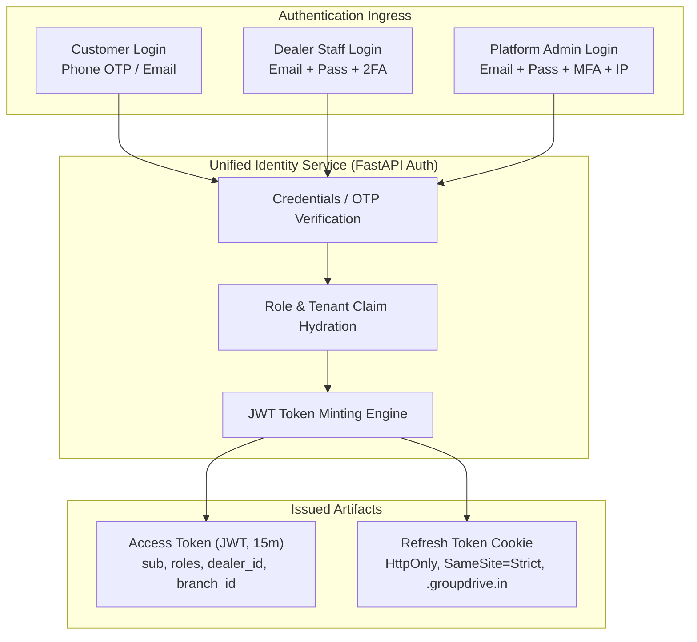
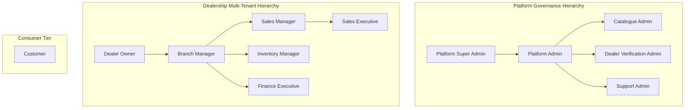
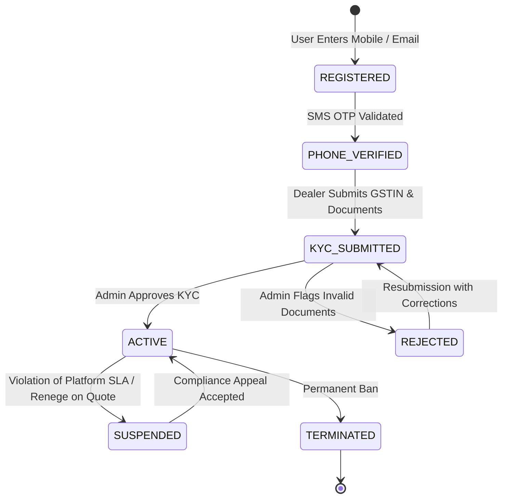

# GroupDrive – Identity, Roles & Permission Matrix

**Document Version:** 1.0.0  
**Status:** Approved Architectural Baseline  
**Classification:** Confidential & Proprietary – GroupDrive Technologies  
**Target Market:** India  
**Date:** November 2026  

---

## 1. Authentication & Identity Architecture

GroupDrive operates a **Unified Multi-Application Identity Service** serving all three frontends:
- **Main Website (`groupdrive.in`):** Customer login via Phone Number + SMS OTP (Primary) or Email + Password / Google OAuth.
- **DealerOS (`dealer.groupdrive.in`):** Dealership Staff login via Work Email + Password + Time-based One-Time Password (TOTP) or SMS OTP.
- **Admin Panel (`admin.groupdrive.in`):** Administrative login via Work Email + Hardware/TOTP Multi-Factor Authentication (MFA) + IP Allowlist restrictions.



### 1.1 JWT Claims Structure
```json
{
  "sub": "550e8400-e29b-41d4-a716-446655440000",
  "email": "vikram@kalyanimotors.com",
  "phone": "+919845012345",
  "roles": ["ROLE_DEALER_OWNER"],
  "dealer_id": "8a2ceb3c-2c6c-4cad-8acc-1a0c6a2cba5c",
  "branch_id": null,
  "iss": "https://api.groupdrive.in",
  "aud": ["https://dealer.groupdrive.in"],
  "iat": 1730910000,
  "exp": 1730910900
}
```

---

## 2. Role Definitions & Hierarchy



### 2.1 Complete Role Registry (12 Core Roles)

1. **`ROLE_CUSTOMER`:** Retail vehicle buyer. Can search, compare, join/create groups, view and accept quotations, and manage bookings.
2. **`ROLE_DEALER_OWNER`:** Dealership franchise principal. Has full administrative access across all branches, inventory, campaigns, staff, and financial reports belonging to their dealership entity.
3. **`ROLE_BRANCH_MANAGER`:** Operational head of a specific showroom/yard branch. Oversees branch sales staff, reviews and approves group quotations, and monitors yard inventory.
4. **`ROLE_SALES_MANAGER`:** Leads sales teams. Configures pricing proposals, monitors unmasked customer leads, and assigns inquiries to Sales Executives.
5. **`ROLE_SALES_EXECUTIVE`:** Dealership front-line representative. Interacts with customers once group booking vouchers are unlocked; coordinates test drives and delivery paperwork.
6. **`ROLE_INVENTORY_MANAGER`:** Manages physical vehicle yard allocations, updates stock serials/VINs, tracks aging stock, and marks units for flash campaigns.
7. **`ROLE_FINANCE_EXECUTIVE`:** Handles customer loan documentation, insurance verification, and statutory tax processing at the dealership branch.
8. **`ROLE_SUPER_ADMIN`:** Root authority over the entire GroupDrive ecosystem. Full access to database, system configurations, audit logs, and administrative user provisioning.
9. **`ROLE_PLATFORM_ADMIN`:** Senior operational manager overseeing daily platform metrics, resolving cross-tenant escalations, and supervising support staff.
10. **`ROLE_DEALER_VERIFICATION_ADMIN`:** Compliance specialist responsible for reviewing dealer franchise agreements, GSTIN validations, and approving/rejecting DealerOS applications.
11. **`ROLE_CATALOGUE_ADMIN`:** Automotive data specialist maintaining master vehicle brands, models, variants, specifications, colours, and official pricing.
12. **`ROLE_SUPPORT_ADMIN`:** Customer and dealer support representative. Handles dispute tickets, user account unlocks, and inquiries with read-only audit logging.

---

## 3. Strict Multi-Tenant Isolation Rules

1. **Horizontal Dealership Segregation:**
   - A user holding `ROLE_DEALER_OWNER` for Dealership A can **never** view inventory, quotes, staff, or campaigns of Dealership B.
   - Enforced by backend database repositories appending `WHERE dealer_id = :authenticated_dealer_id`.
2. **Vertical Branch Isolation:**
   - A `ROLE_BRANCH_MANAGER` or `ROLE_SALES_EXECUTIVE` assigned to Branch 1 cannot access branch-specific customer inquiries or physical stock assigned to Branch 2 under the same dealership unless granted explicit cross-branch supervisor scope.
3. **Consumer Privacy Shield (Zero-Spam Guarantee):**
   - Customer phone numbers, emails, and full identities are completely masked from all dealerships while groups are in `FORMING`, `OPEN_FOR_QUOTES`, or `QUOTATION_REVIEW` stages.
   - Contact details are unmasked **only** to the specific winning dealership whose quotation is accepted by the group member.
4. **Catalogue Immutability:**
   - No dealership role possesses write permissions for `brands`, `vehicle_models`, `vehicle_variants`, or `vehicle_specifications`.

---

## 4. Master Role-Permission Matrix

```
Legend:
[X] = Full Access (Create, Read, Update, Delete)
[R] = Read-Only Access
[S] = Scoped Read/Write (Tenant-isolated to own Dealership or Branch)
[-] = No Access (403 Forbidden)
```

| Permission Key | Customer | Dealer Owner | Branch Manager | Sales Manager | Sales Exec | Inventory Mgr | Finance Exec | Super Admin | Platform Admin | Verification Admin | Catalogue Admin | Support Admin |
|---|:---:|:---:|:---:|:---:|:---:|:---:|:---:|:---:|:---:|:---:|:---:|:---:|
| **Catalogue: Browse & Search** | R | R | R | R | R | R | R | R | R | R | R | R |
| **Catalogue: Edit Master Specs** | - | - | - | - | - | - | - | X | X | - | X | - |
| **Vehicle Media: Upload Official** | - | - | - | - | - | - | - | X | X | - | X | - |
| **Group: Create / Join / Leave** | X | - | - | - | - | - | - | R | R | - | - | R |
| **Group: View Anonymized Demand** | R | S | S | S | S | S | - | R | R | R | R | R |
| **Quotation: Submit Group Bid** | - | S | S | S | - | - | - | R | R | - | - | R |
| **Quotation: View Competing Bids** | - | - | - | - | - | - | - | R | R | - | - | R |
| **Quotation: Accept Winning Deal** | X | - | - | - | - | - | - | - | - | - | - | - |
| **Inventory: Yard Stock CRUD** | - | S | S | S | - | S | - | R | R | - | - | R |
| **Campaign: Create Flash Sale** | - | S | S | - | - | - | - | R | R | - | - | R |
| **Dealer KYC: Submit Application** | - | X | - | - | - | - | - | - | - | - | - | - |
| **Dealer KYC: Approve / Reject** | - | - | - | - | - | - | - | X | X | X | - | - |
| **Staff: Manage Branch Users** | - | S | S | - | - | - | - | R | R | - | - | R |
| **Lead: Access Unmasked Buyer PII**| - | S | S | S | S | - | S | R | R | - | - | R |
| **Audit Logs: View Immutable Trail**| - | - | - | - | - | - | - | X | X | R | R | R |
| **Platform Settings & AI Config** | - | - | - | - | - | - | - | X | - | - | - | - |

---

## 5. Account Verification & Lifecycle State Machine



### 5.1 Account Suspension Triggers
1. **Dealer Quote Default:** Dealership submits an accepted group quote but attempts to alter on-road prices or demand unauthorized handling charges during showroom paperwork. Triggers immediate suspension pending administrative review.
2. **Customer Group Spam:** User creates multiple ghost groups or abandons 3 consecutive locked groups without justification. Triggers temporary group participation cooldown (30 days).

---

## 6. Audit Logging Requirements

Every action executed by administrative or dealership users that mutates state must be recorded in the `audit_logs` table with:
- `actor_user_id` and `actor_role`.
- `client_ip` and `user_agent`.
- `action_code` (e.g., `DEALER_KYC_APPROVED`, `QUOTE_REVISED_DOWNWARD`).
- `before_state` and `after_state` JSON diffs.
- Retention: Minimum 180 days hot storage, 7 years cold storage for Indian legal compliance.

