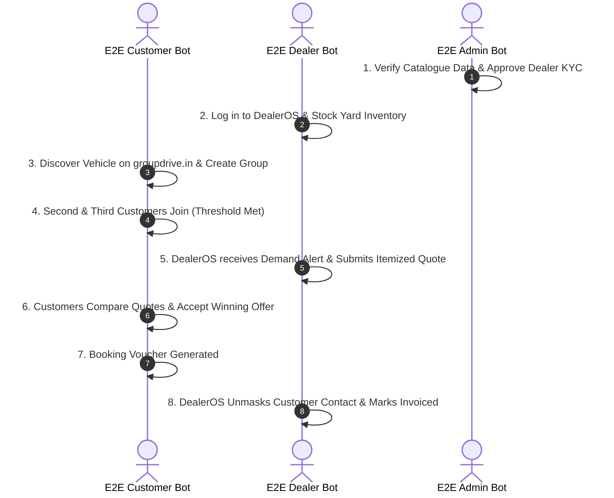

# GroupDrive – Quality Assurance & Testing Strategy

**Document Version:** 1.0.0  
**Status:** Approved Quality Assurance Baseline  
**Classification:** Confidential & Proprietary – GroupDrive Technologies  
**Testing Frameworks:** Pytest (Backend) | Vitest & React Testing Library (Frontend) | Playwright (E2E) | k6 (Performance)  
**Target Market:** India  
**Date:** November 2026  

---

## 1. Quality Engineering Principles & Test Pyramid

GroupDrive adheres to a rigorous, shift-left testing methodology designed to ensure financial accuracy, absolute multi-tenant data segregation, and uninterrupted platform availability.

```
                  /\
                 /  \
                /E2E \         (10% - Playwright Cross-App Flows)
               /------\
              / Integr \       (30% - API Contracts, DB Transactions, Celery)
             /----------\
            /    Unit    \     (60% - Pytest Pure Functions, Pydantic, Vitest)
           /--------------\
```

---

## 2. Testing Levels & Tooling Matrix

| Test Level | Scope | Framework / Tool | Execution Trigger | Minimum Coverage Target |
|---|---|---|---|---|
| **Backend Unit** | Domain models, pricing calculators, comparison logic, Pydantic schemas. | `pytest`, `pytest-asyncio`, `pytest-mock` | Pre-commit / PR | $> 85\%$ lines |
| **Frontend Unit** | React components, UI hooks, math utilities, form validators. | `vitest`, `@testing-library/react` | Pre-commit / PR | $> 80\%$ lines |
| **API Integration** | FastAPI endpoints, DB repositories, Redis cache, JWT validation. | `httpx.AsyncClient`, ephemeral PostgreSQL container | Pull Request | 100% core endpoints |
| **Multi-Tenant Isolation** | Cross-tenant data leakage prevention, branch RBAC guards. | Specialized Pytest matrix suite | Nightly & Pre-Release | 100% dealer queries |
| **End-to-End (E2E)** | Full user journeys across Main Website, DealerOS, and Admin Panel. | `playwright` (Chromium, Firefox, WebKit) | Staging Deployment | 100% P0 Critical Paths |
| **Performance & Load** | API throughput, database connection pool, Redis cache hit rates. | `k6` / `locust` | Pre-Release Milestones | P95 $< 200\text{ ms}$ @ 2k RPS |
| **Security & DAST** | OWASP Top 10, SQLi, BOLA/IDOR, XSS, rate limiting. | `OWASP ZAP`, `bandit`, `semgrep` | Weekly Security Scan | Zero High/Critical CVEs |

---

## 3. Detailed Verification Scenarios & Test Suites

### Suite 01: Authentication, OTP & Session Security
- **TC-AUTH-01 (Valid Mobile OTP):** Request OTP for Indian mobile (`+919876543210`); simulate SMS gateway receipt; submit valid 6-digit code. *Expected:* HTTP 200, JWT returned, refresh cookie set.
- **TC-AUTH-02 (OTP Expiry & Brute Force):** Attempt 5 invalid OTP guesses. *Expected:* Account temporarily locked for 15 minutes; rate limiter returns HTTP 429.
- **TC-AUTH-03 (Refresh Token Rotation):** Invoke `/api/v1/auth/refresh` with valid cookie. *Expected:* Old refresh token invalidated; new refresh token issued; access token lifetime = 15m.
- **TC-AUTH-04 (Token Replay Attack):** Present an invalidated prior refresh token. *Expected:* System detects reuse, revokes all sessions associated with user, logs security alert.

### Suite 02: Multi-Tenant Dealership Isolation & RBAC
- **TC-TENANT-01 (Cross-Dealership Read Prevention):** Authenticate as Sales Executive of Dealership A (`dealer_id: 1111`). Attempt to GET `/api/v1/inventory/{id}` belonging to Dealership B (`dealer_id: 2222`). *Expected:* HTTP 404 or HTTP 403 Forbidden.
- **TC-TENANT-02 (Branch Boundary Enforcement):** Authenticate as Branch Manager of Branch 1. Attempt to assign an inquiry belonging to Branch 2 under the same dealership. *Expected:* HTTP 403 Forbidden unless user has `ROLE_DEALER_OWNER`.
- **TC-TENANT-03 (Customer Privacy Shield):** Dealer queries active groups in their city. *Expected:* Phone numbers and emails of group members are masked (`+91******43210`, `a***v@email.com`).

### Suite 03: Central Catalogue Immutability
- **TC-CAT-01 (Dealer Unauthorized Write Attempt):** Authenticate with `ROLE_DEALER_OWNER`. Attempt `POST /api/v1/catalogue/models` or `PATCH /api/v1/catalogue/variants/{id}`. *Expected:* HTTP 403 Forbidden. Master specifications remain unchanged.
- **TC-CAT-02 (Super Admin Spec Mutation):** Authenticate with `ROLE_SUPER_ADMIN`. Update ARAI mileage for Tata Nexon variant. *Expected:* HTTP 200; update written; immutable entry appended to `audit_logs`.

### Suite 04: Group Purchasing Lifecycle & Concurrency
- **TC-GRP-01 (Group Creation & RTO Jurisdiction):** Customer in Bengaluru creates group for Hyundai Creta. *Expected:* Group created with status `FORMING`, min threshold 3, max capacity 15.
- **TC-GRP-02 (Geographic Join Validation):** Customer with registered city Mumbai attempts to join Bengaluru group. *Expected:* HTTP 400 Bad Request ("Customer location is incompatible with group delivery jurisdiction").
- **TC-GRP-03 (Concurrent Join Capacity Lock):** Simulate 5 concurrent customer requests attempting to join a group with only 2 remaining slots using parallel threads. *Expected:* PostgreSQL `SELECT ... FOR UPDATE` locks row atomically; exactly 2 requests succeed; 3 requests receive HTTP 409 Group Full.
- **TC-GRP-04 (Automatic Quoting Trigger):** Third member joins group. *Expected:* Group status automatically transitions from `FORMING` to `OPEN_FOR_QUOTES`; 72-hour quoting countdown initialized; Celery task dispatches notifications to authorized local dealers.

### Suite 05: Dealer Quotation Engine & Statutory Math Integrity
- **TC-QTE-01 (Itemized Quotation Mathematical Validation):** Dealer submits quote with:
  - Ex-Showroom: ₹10,00,000
  - RTO: ₹1,40,000
  - Insurance: ₹35,000
  - Group Discount: ₹40,000
  - Net Payable: ₹11,35,000.
  *Expected:* Backend verifies mathematical equality; returns HTTP 201 Created.
- **TC-QTE-02 (Disguised Handling Fee Rejection):** Dealer submits quote containing an unauthorized line item ("Depot Logistics Fee: ₹15,000"). *Expected:* Validation rule triggers HTTP 422 Unprocessable Entity ("Non-statutory logistics charges are prohibited").
- **TC-QTE-03 (Negative Discount Prevention):** Dealer submits negative discount. *Expected:* Schema rejects submission with validation error.

### Suite 06: Smart Comparison & AI Explainer Verification
- **TC-COMP-01 (Deterministic Spec Differencer):** Submit comparison request for 2 trims of Tata Nexon (Creative vs Fearless). *Expected:* System accurately outputs that Fearless has Ventilated Seats and 360 Camera, while Creative does not. Zero missing specs; response time $< 100\text{ ms}$.
- **TC-AI-01 (Gemini Narrative Verification):** Call `/api/v1/ai/explain-comparison` with mock Gemini response. *Expected:* Narrative strictly utilizes provided JSON attributes; tests verify no hallucinated horsepower or price figures are introduced into the narrative.
- **TC-AI-02 (Gemini Fallback Handling):** Simulate Google Gemini API outage (HTTP 500 / Timeout). *Expected:* Comparison endpoint falls back gracefully to pure deterministic tabular view without throwing an unhandled exception.

---

## 4. End-to-End (E2E) Test Flow (Playwright)



---

## 5. Performance & Load Testing Benchmarks

- **Tool:** `k6` executing automated load scripts in staging.
- **Target Profile:** 2,000 concurrent virtual users simulating realistic marketplace browsing (70% catalogue browsing, 20% comparison queries, 10% group actions).
- **Quality Benchmarks:**
  - P95 API Latency: $< 200\text{ ms}$.
  - P99 API Latency: $< 500\text{ ms}$.
  - Error Rate: $< 0.1\%$ across all requests.
  - PostgreSQL Connection Pool: Saturation $< 80\%$ under maximum load.

---

## 6. Quality Gates & Definition of Done (DoD)

A feature is considered **Done** and eligible for production release only when:
1. **Unit & Integration Tests:** 100% of existing and new tests pass in CI.
2. **Code Coverage:** Minimum 85% statement coverage for new domain logic.
3. **Static Analysis & Linting:** Zero errors from `ruff`, `mypy` (strict mode), `eslint`, and `tsc`.
4. **Security Clearance:** Zero High or Critical vulnerabilities identified by static code analysis and dependency scanners.
5. **E2E Verification:** Automated Playwright regression test suite passes on the staging cluster.
6. **Documentation Updated:** API contracts reflected in OpenAPI; architecture and database schemas updated if altered.

